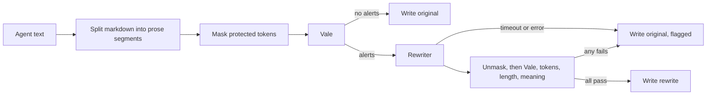

# Simplifying agent-produced prose

The finding of S-0413. The operator asked for research on making the prose flai's agents write simpler and shorter, so that the operator and other agents read less and read it faster. The operator named two means: a natural language linter, such as Vale or proselint, and a small model hosted locally and fitted with LoRA or a similar method, which rewrites verbose agent text until it passes that linter. This document says what prose flai's agents write today and what checks it, then covers prose linters, a local rewriting model, and the alternatives, and ends with a recommendation. Nothing here is built.

Every figure about this repository comes from a command run on 2026-10-16. Design documents and ADRs are linked; code is named by its path.

## Today

Measured on 2026-10-16 over the committed tree at `53eb8e40`, with a Python script kept outside the repository. A word is a run of letters and digits outside front matter, fenced code, and HTML comments. An entry is a `###` section under a narrative's `## Log` or under a thread's or message's `## Entries`. Live and archived files are counted together.

| Kind | Path | Reader | Files | Words | Median words per file | Entries | Median words per entry |
|------|------|--------|-------|-------|-----------------------|---------|------------------------|
| Story narratives | `wip/agents/S-*.md`, `wip/archive/agents/` | The agent that resumes the story; the operator | 381 | 236,110 | 556 | 1,989 log entries | 20 |
| Strategic agents' activity logs | `wip/agents/planner.md`, `orchestrator.md`, `analyzer.md` | The operator; that agent's next session | 3 | 35,031 | 4,236 | 645 | 49 |
| Threads | `wip/threads/` | The operator and agents | 468 | 173,488 | 317 | 1,012 agent entries | 105 |
| Messages between agents | `wip/messages/` | The two stories' agents; the operator on escalation | 126 | 47,026 | 308 | 554 agent entries | 64 |
| Epics | `wip/kanban/epics/`, `wip/archive/kanban/epics/` | The operator and agents | 25 | 11,338 | 304 | | |
| Stories | `wip/kanban/stories/`, `wip/archive/kanban/stories/` | The operator and agents | 413 | 219,461 | 524 | | |
| Tasks | `wip/kanban/tasks/`, `wip/archive/kanban/tasks/` | Agents; the operator | 1,719 | 266,613 | 133 | | |
| Issues | `design/issues/I-*.md` | The operator, agents, the analyzer | 146 | 43,509 | 204 | | |
| ADRs | `design/adrs/` | The operator and agents | 162 | 107,983 | 639 | | |
| Design documents | `design/system/` | The operator and agents | 26 | 206,366 | 3,490 | | |
| Analyzer reports | `design/analysis/` | The operator | 1 | 1,983 | 1,983 | | |
| Commit messages | `git log`, commits with a Claude trailer | The operator | 1,955 | 117,132 | 59 | 1,411 with a body | 58 per body |
| Final report to the operator | Not stored in the repository | The operator | | | | | |

The kinds above hold 1,466,040 words. A small part is not agent prose: the operator's thread entries, flai's own notices in threads and messages, the operator's brief, and the goals the operator writes for stories.

- A narrative's largest section is `## Decisions`: 89,314 words across the 381 narratives, against 63,672 in `## Log` and 46,242 in `## Current state`, each counted with its heading.
- Threads hold 1,558 entries. Agents wrote 1,012 of them, 151,764 words. The operator wrote 401, 2,674 words, with a median of 1 word: 161 of them are `Resolved.` alone. flai wrote 145, 9,506 words.
- Messages hold 635 entries; flai wrote 81 of them.
- The repository has 2,954 commits. 1,955 carry a Claude trailer. Of the other 999, 278 carry flaiover's trailer and 721 carry none.
- The design documents include the operator's [brief](brief.md), 865 words, and this folder's README.
- The final report goes to the operator in the harness's session, not to a file. The harness keeps it in its session log, which flai reads for usage only (`flai/internal/usage`).

### Readability

Measured over the same tree with the same script. Sentences are split at `.`, `!`, or `?` followed by a space and a capital or a digit, within paragraph and list lines. Headings, tables, and code are left out, and an inline code span counts as one word. The Flesch-Kincaid grade uses a heuristic syllable count, so it compares rows rather than standing alone.

| Prose | Sentences | Mean words per sentence | Median words per sentence | Sentences over 25 words | Flesch-Kincaid grade |
|-------|-----------|-------------------------|---------------------------|-------------------------|----------------------|
| Narrative log entries | 4,150 | 13.7 | 11 | 13% | 6.8 |
| Narratives, whole | 12,746 | 16.9 | 15 | 20% | 7.5 |
| Strategic agents' log entries | 3,363 | 9.8 | 5 | 10% | 6.2 |
| Thread entries by agents | 10,277 | 12.9 | 12 | 6% | 5.5 |
| Message entries by agents | 1,857 | 13.7 | 12 | 12% | 5.2 |
| Epics | 484 | 22.4 | 18 | 33% | 10.5 |
| Stories | 10,631 | 18.0 | 16 | 20% | 8.1 |
| Tasks | 14,200 | 16.5 | 14 | 16% | 6.6 |
| Issues | 2,178 | 18.5 | 15 | 26% | 8.5 |
| ADRs | 4,868 | 20.7 | 19 | 28% | 8.9 |
| Design documents | 4,573 | 22.2 | 19 | 32% | 9.2 |
| Analyzer reports | 69 | 21.3 | 21 | 33% | 8.0 |
| Commit messages | 11,013 | 10.6 | 11 | 1% | 5.5 |

Sentences are shortest in commits, threads, messages, and logs. They are longest in the documents agents write for later reading: design documents, epics, ADRs, the analyzer's report, and issues. There a quarter to a third of sentences run past 25 words.

### What checks this prose today

| Check | What it checks | Enforced |
|-------|----------------|----------|
| [Communication convention](../conventions/communication.md) | Reports to the operator: lead with the outcome, one idea per sentence, short sentences with verbs, no restatement of the request, no praise | No. Agents read it in every prime pack. |
| [Documentation convention](../conventions/documentation.md) | Documents: write plainly, tables for parallel facts, short sentences, no filler, no marketing, no duplicated content | No. Agents read it in every prime pack. |
| flai's markdown lint, [ADR-0061](../adrs/0061-flai-lints-the-markdown-it-writes-in-wip-with-its-own-implementation-of-the.md) | 23 markdownlint rules on the work items, threads, and narratives flai writes in `wip/`: headings, lists, whitespace, bare URLs, code fences, emphasis, tables | Yes. Package `flai/internal/mdlint`: `flai check` reports a finding, and a command that writes refuses one. |
| The `markdown` test tier in [system-flow.yaml](../../system-flow.yaml) | Every markdown file, through `scripts/lint-md.sh`, which runs markdownlint-cli2 0.20.0 with `.markdownlint.yaml` | Yes, in `flai test` and the close-out. Line length (MD013) is off. |
| Title limits | A conversation's title is cut to 72 runes (`flai/internal/messages`); the host API refuses an epic or story title over 200 characters (`flai/internal/hostapi`) | Yes, on titles only. |
| The prime pack's size budget, [ADR-0049](../adrs/0049-a-story-s-context-pack-fits-a-size-budget-what-the-story-names-loads-whole-what.md) | What an agent reads at story start: 81,920 bytes by default (`flai/internal/context`) | Yes, on what is read, not what is written. |

Nothing checks the prose itself. On 2026-10-16 a search of `flai/`, `flaiover/src/`, `template/`, `scripts/`, the manifest, and the repository's configuration found no check of sentence length, wordiness, passive voice, or readability. It found no prose linter such as Vale, proselint, write-good, or textlint. The two conventions state the style; agents follow them or not, and no tool measures the result.

The prime budget is the one place flai limits what an agent reads, and conventions alone exceed it. `flai prime --story S-0413 --json`, run on 2026-10-16, reports a pack of 128,217 bytes in 1,114 lines against the 81,920-byte budget, exceeded by conventions. The 14 conventions it loads whole come to 81,868 bytes, and their README to 3,063 more. The largest are [work-management.md](../conventions/work-management.md), 21,819 bytes, and [delegation.md](../conventions/delegation.md), 13,167 bytes.

## Prose linters

Criterion 1. This section compares the natural language linters that could check what agents write, records a trial of the strongest on this repository's prose, and recommends one. The linter would also score the training data and the output of a rewriting model ([A local rewriting model](#a-local-rewriting-model)), so machine-readable output, per-rule alerts, and rules the project can write matter as much as what a tool checks out of the box.

| Tool | Checks | Configurable rules | Markdown aware | Runtime | Output | Licence | Last release | Fit |
|------|--------|--------------------|----------------|---------|--------|---------|--------------|-----|
| [Vale](https://github.com/vale-cli/vale) | Whatever its styles define: word lists, sentence length, readability formulas, capitalisation, consistency | Yes. Each rule is a YAML file built on one of 12 [check types](https://docs.vale.sh/checks/), turned on, off, or re-levelled in `.vale.ini` | Yes. It skips code blocks, code spans, and URLs ([markdown](https://docs.vale.sh/formats/markdown)). It lints front matter unless `BlockIgnores` excludes it | One static Go binary, 56 MB. Reads files or stdin (`--ext=.md`) | `--output=JSON`, line, CLI, or a template ([CLI](https://docs.vale.sh/cli)) | MIT | v3.24.0, 2026-10-01 | Best |
| [Harper](https://github.com/Automattic/harper) | Grammar and spelling: about 900 rules, mostly fixed-phrase corrections, with `LongSentences`, `Hedging`, and `FillerWords` | On and off with `--only` and `--ignore`. Custom rules in the [Weir](https://writewithharper.com/docs/weir) language | Yes. It skipped front matter and code in the trial | One Rust binary, 58 MB (`harper-cli`) | `--format json`, with rule, span, line, and suggestions | Apache-2.0 | v2.12.0, 2026-10-01 | Good for grammar, weak for brevity |
| [proselint](https://github.com/amperser/proselint) | Usage: clichés, redundancy, hedging, weasel words, typography | On and off only (`.proselintrc.json`). No new rules | No. It lints front matter, code spans, and fenced code | Python 3.10 or newer | `-o json` | BSD-3-Clause | 0.16.0, 2025-11-14 | Poor. Vale ships the same checks as a package |
| [write-good](https://github.com/btford/write-good) | Passive voice, weasel words, "there is", adverbs, wordiness | Flags turn checks on or off; a JavaScript checks module can be passed in | No | Node | Text | MIT | 1.0.8, 2022-06-29 | Poor. Unmaintained, and also a Vale package |
| [textlint](https://github.com/textlint/textlint) | Nothing by itself. Rules come from npm: `sentence-length` (characters, not words), `write-good`, `max-comma`, `stop-words` | Yes, as JavaScript rules | Yes, with its markdown plugin | Node 20 or newer, about 55 MB of `node_modules` | `-f json` | MIT | v15.8.0, 2026-08-01 | Fair. Slow, and every rule is another npm dependency |
| [LanguageTool](https://github.com/languagetool-org/languagetool) | Grammar and style, with a picky level | `disabledRules` and `enabledRules` per request ([API](https://languagetool.org/http-api/)) | No. The caller strips markdown | Java HTTP server, about 250 MB | JSON | LGPL-2.1 | 6.8, 2026-05-05 | Poor. A heavy server for a style job |
| [alex](https://github.com/get-alex/alex) | Insensitive wording | Allow lists | Yes | Node | Text; JSON unverified | MIT | 11.0.0, 2022-11-04 | Not about brevity |
| [coala](https://github.com/coala/coala) | A framework of plug-ins ("bears") | Yes | Through bears | Python | JSON | AGPL-3.0 | 0.11.0, 2017-05-22 | Dead |
| [textstat](https://github.com/textstat/textstat) | Readability scores for a whole text: Flesch-Kincaid and others | None. A library | No | Python | Numbers | MIT | 0.7.13, 2026-02-18 | Scores training data in Python. Not a linter |
| [markdownlint-cli2](https://github.com/DavidAnson/markdownlint-cli2) | Markdown structure, no prose | Yes | Yes | Node | Text, JSON | MIT | 0.23.3; `scripts/lint-md.sh` pins 0.20.0 | In use already. Not a prose tool |
| [slop-cop](https://github.com/yasyf/slop-cop) | 226 rules for text that "sounds like an LLM", with optional tiers that call an LLM | Unverified | Yes | Go binary | JSON | MIT | v0.1.73, 2026-10-07 | Watch only. Young |

Release dates and licences come from the GitHub, npm, and PyPI pages and APIs, read on 2026-10-15 and 2026-10-16.

Other finds:

- [vale-ai-tells](https://github.com/krishnasunkam/vale-ai-tells) is a Vale package of 17 rules for patterns typical of AI writing. It is new, with one star: a source of rule ideas, not a dependency.
- [vale-cli/Harper](https://github.com/vale-cli/Harper) ports 455 of Harper's rules into a Vale style.
- Vale's code sits under `internal/`, so Go cannot import it. flai would run it as a process, as the `golangci-lint` tier does.
- [neurosnap/sentences](https://github.com/neurosnap/sentences) (MIT) splits text into sentences in Go, if flai counts words per sentence itself.

### Trial on this repository

The corpus was 14 files, about 6,388 words once front matter and fenced code were removed: the narratives `wip/archive/agents/S-0386.md` to `S-0389.md` and `S-0391.md`, the threads `TH-0447` to `TH-0451`, and the issues `I-0150` to `I-0153`. The tools ran from a scratch install in the git-ignored `bin/prose-trial/`, with every configuration outside the repository.

| Run | Alerts | Per 1,000 words | Wall time |
|-----|-------:|----------------:|----------:|
| Vale with the Microsoft, Google, write-good, proselint, and Readability packages and custom rules, untuned | 1,335 | 209.0 | 0.35 s |
| Vale with the recommended set below | 113 | 17.7 | 0.23 s |
| proselint 0.16.0, defaults | 16 | 2.5 | 0.35 s |
| Harper 2.12.0, defaults | 572 | 89.5 | 1.9 s |
| Harper without `SpellCheck`, `UseTitleCase`, and `SentenceCapitalization` | 29 | 4.5 | |
| textlint 15.8.0 with write-good, sentence-length, max-comma, stop-words | 186 | 29.1 | 6.0 s |
| textstat 0.7.13, one score per document | 14 documents | Flesch-Kincaid grade 4.5 to 11.6 | 0.86 s |

This prose has almost no filler. The custom rules found no filler word, hedge, praise, or apology in the 6,388 words. Its length comes from structure:

| Pattern | Hits | Example |
|---------|-----:|---------|
| Sentence over 25 words | 25 | "Kept the planner's seven tasks and their layers as drafted (story Notes § Planning): layer 1 T-1576, T-1577, T-1578 wait for none and share no path; layer 2 T-1579 waits for T-1577 and T-1578, …" (S-0388, 70 words) |
| Semicolon joining two ideas | 33 | "accept_reviews on since 2026-10-07; the orchestrator declined …" (I-0150) |
| More than three item IDs in one sentence | 13 | "S-0216 305,070, S-0215 303,610, S-0214 301,459, S-0213 298,706, …" (I-0153) |
| Two or more parentheticals in one sentence | 9 | "S-0341 (361,859 s), S-0342 (321,146 s), and S-0343 (250,881 s)" (I-0150) |
| Title over 25 words | 6 | "# S-0388 The review page shows each path a story's branch undoes on main as a card, with Restore, Keep with a reason, and Send back, …" |
| Document over a readability limit of grade 8 | 6 of 14 | I-0150, grade 10.2 |

A made-up paragraph in a chatty style ("Great question! Let me take a look … I think the issue might basically be …") tested whether each tool sees filler at all. Vale with the custom rules raised 21 alerts on it, proselint 1, and Harper 1, a false positive.

False positives seen:

- **Vale, untuned.** It linted front matter until `BlockIgnores` excluded it. Google.Headings flagged every timestamp heading. write-good.E-Prime flagged every "is" (167 hits), and Readability.Polysyllables flagged "operator" (169).
- **Vale, sentence length.** With the default token, a path counted as many words. The letters-only token below took the long-sentence count from 41 to 25. Four alerts pointed one line early.
- **proselint.** About 14 of its 16 hits were false: "ADR-0050's" read as a decade, and number lists as repeated words.
- **Harper.** 432 spelling hits fell on IDs and timestamps such as `TH`, `ADR`, and `flai`; a user dictionary would remove most. 62 title-case hits fell on sentence-case headings.
- **textlint.** write-good raised 119 hits, mostly "only can weaken meaning". `sentence-length` counts characters, so it cannot express a word limit.

### Recommendation

Adopt Vale, with a project style of nine rules written from [communication.md](../conventions/communication.md) and a few rules from the public packages. Keep Harper in reserve as a grammar checker. The others do not fit: proselint and write-good ship inside Vale as packages, textlint is slow and counts characters, LanguageTool is a Java server, alex is not about brevity, and coala is dead.

Reasons:

- Each mechanical rule of the communication convention fits a Vale check type: short sentences, one idea per sentence, no filler, no praise, no apology, no narration, and data sets out of prose.
- It is one Go binary with no runtime, like the tools flai runs already.
- Its JSON names the rule, line, and span of every alert. That gives the per-rule rate per 1,000 words that scores a rewriting model.
- It reads markdown, and it ran in 0.23 s on the corpus.
- It was the only tool that caught filler, hedges, praise, and narration in the chatty sample, and with front matter excluded it raised nothing on IDs, paths, or code.

Leave out the Google and Microsoft styles. They raised 209 alerts per 1,000 words and conflict with the first-person voice of threads.

The starting `.vale.ini`:

```ini
StylesPath = .vale/styles
MinAlertLevel = suggestion
Packages = write-good, proselint, Readability

[*.md]
BasedOnStyles = Vale, Flow, write-good, proselint, Readability
BlockIgnores = (?s)\A---\n.*?\n---\n
Vale.Spelling = NO
write-good.E-Prime = NO
write-good.Passive = NO
write-good.TooWordy = NO
Readability.Polysyllables = NO
```

The project style, `Flow`, one YAML file per rule, shown as one listing:

```yaml
# Flow/SentenceLength.yml. The token counts letter words only, so paths, IDs, and numbers do not count.
extends: occurrence
message: "Sentence has more than 25 words. Split it."
scope: sentence
level: warning
max: 25
token: (?<![\w/.\-])[A-Za-z][A-Za-z']*(?![\w/.\-])
---
# Flow/Semicolon.yml
extends: existence
message: "A semicolon joins two ideas. Make two sentences."
level: suggestion
nonword: true
tokens: [";"]
---
# Flow/Parens.yml
extends: occurrence
message: "More than one parenthetical in a sentence. Give each aside its own sentence."
scope: sentence
level: suggestion
max: 1
token: \([^)]*\)
---
# Flow/IDDensity.yml
extends: occurrence
message: "More than three item IDs in one sentence. Use a table or a list."
scope: sentence
level: suggestion
max: 3
token: \b(?:S|T|E|I|TH|MS|ADR)-\d{4}\b
---
# Flow/Filler.yml
extends: existence
message: "Cut the filler '%s'."
ignorecase: true
level: warning
tokens: [basically, actually, really, simply, just, very, quite, in order to,
  note that, it is worth noting, it should be noted, as mentioned,
  as noted above, of course, essentially, successfully, went ahead and]
---
# Flow/Hedge.yml
extends: existence
message: "Hedge '%s'. Say what is, or say it is unverified."
ignorecase: true
level: suggestion
tokens: [might, perhaps, possibly, probably, seems to, appears to,
  I think, I believe, arguably, somewhat]
---
# Flow/Praise.yml
extends: existence
message: "Praise nothing: '%s'."
ignorecase: true
level: error
tokens: [great question, excellent, perfect, awesome, fantastic,
  you're right, good catch]
---
# Flow/Narration.yml
extends: existence
message: "Report results, not your reasoning or tool use: '%s'."
ignorecase: true
level: warning
tokens: [let me, I'll now, I will now, I'm going to, I need to, "first, I"]
---
# Flow/Apology.yml
extends: existence
message: "Skip the apology '%s'. State the correction."
ignorecase: true
level: warning
tokens: [sorry, apologies, I apologize]
```

flai could call it in three places:

| Where | How | Status |
|-------|-----|--------|
| A test tier in `system-flow.yaml` | `{name: prose, command: [scripts/lint-prose.sh, "{files}"], paths: ["wip/**/*.md", "design/**/*.md"], format: plain}`, advisory at first, with only `Flow.Praise` at error level. A `vale-json` format would give structured findings later; flai has none today | Not built |
| A check on what flai writes | flai pipes a thread entry, item body, or commit message to `vale --output=JSON --ext=.md` and returns the alerts in the write's answer, or refuses the write, as its markdown lint does (alternative 5 below) | Not built |
| The scorer of a rewriting model | Alerts per 1,000 words per check, and the readability values. Vale prints a metric only when its condition fails, so continuous scores need copies of the Readability rules whose condition always holds | Not tested |

Two choices come first: how Vale is installed (a pinned download in a script, as `scripts/lint-md.sh` does with markdownlint-cli2, recorded in `design/tech/`), and whether `Flow` ships in `template/` for every project or stays in this repository.

Not checked in the trial: LanguageTool, alex, and slop-cop were not run; Vale on commit messages; and the always-on metric rules. The false-positive counts are a reading of each hit, not a measured precision.

### Sources

- Vale: [v3.24.0](https://github.com/vale-cli/vale/releases/tag/v3.24.0), [check types](https://docs.vale.sh/checks/), [Markdown](https://docs.vale.sh/formats/markdown), [CLI](https://docs.vale.sh/cli), [packages](https://github.com/vale-cli/packages)
- Harper: [v2.12.0](https://github.com/Automattic/harper/releases/tag/v2.12.0), [Weir](https://writewithharper.com/docs/weir), [Vale port](https://github.com/vale-cli/Harper)
- proselint: [v0.16.0](https://github.com/amperser/proselint/releases/tag/v0.16.0), [PyPI](https://pypi.org/project/proselint/)
- write-good: [repository](https://github.com/btford/write-good), [npm](https://www.npmjs.com/package/write-good)
- textlint: [v15.8.0](https://github.com/textlint/textlint/releases/tag/v15.8.0), [sentence-length](https://www.npmjs.com/package/textlint-rule-sentence-length)
- LanguageTool: [changes](https://github.com/languagetool-org/languagetool/blob/master/languagetool-standalone/CHANGES.md), [HTTP server](https://dev.languagetool.org/http-server), [HTTP API](https://languagetool.org/http-api/)
- [alex](https://github.com/get-alex/alex), [coala](https://github.com/coala/coala), [textstat](https://github.com/textstat/textstat), [markdownlint-cli2](https://github.com/DavidAnson/markdownlint-cli2), [slop-cop](https://github.com/yasyf/slop-cop), [vale-ai-tells](https://github.com/krishnasunkam/vale-ai-tells), [neurosnap/sentences](https://github.com/neurosnap/sentences)

## A local rewriting model

Criterion 2. This section evaluates open-weight models that could be fitted, with LoRA or another method, to run on consumer hardware and rewrite verbose agent prose until it passes the linter recommended above. It covers the candidates, the approaches, the hardware, how flai would call a model, a training and evaluation plan, and the costs and risks.

The short answer: small open models in 2026 make this practical on a GPU or an Apple Silicon Mac. On the operator's host, which has no GPU visible to WSL, a rewrite takes 6 to 17 seconds per paragraph. A prompted hosted model does the same job for cents a day with nothing to install. A trained local model pays only when text must not leave the host, or when prompted models miss the quality thresholds below.

Facts about models come from their model cards and vendors' pages, read on 2026-10-16. Figures marked *est.* are estimates, scaled from the measured rows by model size.

### Candidate models

| Family | Sizes | Licence | Context | Notes for rewriting |
|--------|-------|---------|---------|---------------------|
| Qwen3.5 | 0.8B, 2B, 4B, 9B, dense | Apache-2.0 ([4B](https://huggingface.co/Qwen/Qwen3.5-4B), [9B](https://huggingface.co/Qwen/Qwen3.5-9B)) | 262,144 for 4B and 9B; smaller sizes not checked | Released February to March 2026. Thinking is on by default; `enable_thinking: false` turns it off. [Unsloth](https://unsloth.ai/docs/models/qwen3.5/fine-tune) has notebooks for 0.8B to 4B |
| Gemma 4 | E2B (5.1B total), E4B (8B total), 12B | Apache-2.0 ([card](https://huggingface.co/google/gemma-4-E4B-it)) | 128K for E2B and E4B; 256K for 12B | Released 2026-04-02. Memory follows total parameters, not effective ones |
| Granite 4.1 | 3B, 8B, dense, text only | Apache-2.0 ([card](https://huggingface.co/ibm-granite/granite-4.1-8b)) | 131,072 | Released 2026-04-29. Text only and dense, so QLoRA is the plain path |
| Ministral 3 | 3B, 8B, 14B | Apache-2.0 for 8B ([card](https://huggingface.co/mistralai/Ministral-3-8B-Instruct-2512)); 3B not checked | 256K | Released December 2025. Instruct weights ship in FP8 |
| Phi-4-mini | 3.8B | MIT ([card](https://huggingface.co/microsoft/Phi-4-mini-instruct)) | 128K | Released February 2025, older than the rest |
| SmolLM3 | 3B | Apache-2.0 ([card](https://huggingface.co/HuggingFaceTB/SmolLM3-3B-Base/blob/refs%2Fpr%2F4/README.md)) | 64K, 128K with YaRN | Weights, data, and recipe all open |
| Llama 3.2 | 1B, 3B | Llama 3.2 Community License ([card](https://huggingface.co/meta-llama/Llama-3.2-3B-Instruct)) | 128K | Gated. A distributed fine-tune must start its name with "Llama" |
| LFM2 | 2.6B | LFM Open License v1.0 ([card](https://huggingface.co/LiquidAI/LFM2-2.6B)) | 32,768 | Commercial use is conditional. Left out |

Every candidate's context covers inputs of a few thousand tokens. The licence narrows the field to Qwen3.5, Gemma 4, and Granite 4.1: Apache-2.0 and current. Qwen3.5 has the widest ladder of sizes, so one recipe trains a 2B for a CPU and a 4B for a GPU.

### Approaches

| Approach | What it is | When it fits |
|----------|------------|--------------|
| Prompted small model | A base instruct model gets the style rules and three examples. No training | The baseline every trained model must beat |
| Prompted hosted model | Claude Haiku 5.5 with the same prompt | The baseline on cost and quality |
| Supervised fine-tune (SFT) with LoRA | Rank 8 to 32 adapters trained on pairs of verbose text and its rewrite, on a frozen base | The main path |
| SFT with QLoRA | LoRA on a base loaded in 4 bits, about a third of the memory | Granite, Gemma, or Ministral on a GPU of 8 GB or less. Unsloth advises against it for Qwen3.5, whose quantization error is high |
| Full fine-tune of a tiny model | Every weight of a 0.8B to 2B model is trained | Rarely worth it. LoRA makes the same style change with a tenth of the memory |
| Distillation | A large teacher writes the targets; the student learns them | Always the data source. SFT on a teacher's pairs is distillation |
| DPO | Learns from pairs of a passing and a failing teacher output | A second stage, when SFT outputs still trip the linter |
| GRPO | Online reinforcement learning: the model samples rewrites and reward functions score them ([TRL](https://huggingface.co/docs/trl/main/en/grpo_trainer), [Unsloth](https://unsloth.ai/docs/get-started/reinforcement-learning-rl-guide)) | A third stage. The rewards: fewer Vale alerts, every protected token kept, a length term, and entailment. A model can game them by deleting content, so the meaning reward must stop that |
| Quantization | GGUF Q4_K_M for CPU and Mac, Q8_0 for GPU ([llama.cpp](https://github.com/ggml-org/llama.cpp/blob/master/tools/quantize/README.md)) | Always, for inference |

The linter enters every approach the same way: text in, alerts out. Vale's JSON gives each alert's `Check`, `Line`, `Span`, `Severity`, and `Message`. Any linter that gives that list can stand in for Vale.

### Hardware

GGUF Q4_K_M takes about 0.61 bytes per parameter, plus 0.3 to 1.5 GB for the cache of a 4K to 8K context. Generation speed follows memory bandwidth.

| Size | Q4_K_M memory | Operator's host: Ryzen 9 3900X, DDR4, CPU only | RTX 3060 12 GB | RTX 4060 Ti 16 GB | Apple M2 | Apple M4 Pro |
|------|---------------|------------------------------------------------|----------------|-------------------|----------|--------------|
| 2B | 1.5 to 2.5 GB | 20 to 30 tok/s *est.* | ~200 tok/s *est.* | ~170 tok/s *est.* | ~60 tok/s *est.* | ~130 tok/s *est.* |
| 4B | 3 to 4 GB | 10 to 15 tok/s *est.* | 110 to 130 tok/s *est.* | ~100 tok/s *est.* | ~35 tok/s *est.* | ~80 tok/s *est.* |
| 7B to 8B | 5 to 6 GB | 6 to 8 tok/s ([guide](https://bestllmfor.com/guide/llm-local-cpu-sans-gpu/)) | 76 tok/s ([llama.cpp](https://github.com/ggml-org/llama.cpp/discussions/15013)) | 64 tok/s (same) | 21.7 tok/s ([llama.cpp](https://github.com/ggml-org/llama.cpp/discussions/4167)) | 50 tok/s (same) |
| 14B | 9.5 to 10 GB | 3 to 4 tok/s *est.* | Just fits | Fits | Tight at 16 GB | Fits |

A typical rewrite reads about 350 tokens and writes about 150. That gives these times per rewrite:

| Where | 2B | 4B | 8B |
|-------|----|----|----|
| Operator's host, CPU only | 6 to 9 s | 12 to 17 s | 25 to 35 s |
| RTX 3060 or 4060 Ti | under 1 s | ~1.5 s | ~2.5 s |
| Apple M2 | ~3 s | ~5 s | ~9 s |

The operator's host shows only a d3d12 device inside WSL, so CUDA is not available there, and Vulkan through the Dozen driver has overhead ([llama.cpp](https://github.com/ggml-org/llama.cpp/pull/16689)). If the Windows side has an NVIDIA or AMD GPU, llama-server can run on Windows and flai in WSL can reach it at `127.0.0.1` under mirrored networking. That GPU is unknown.

Training needs a GPU. Unsloth's minimums ([requirements](https://www.unsloth.ai/docs/get-started/fine-tuning-for-beginners/unsloth-requirements)):

| Model | QLoRA, 4-bit | LoRA, 16-bit |
|-------|--------------|--------------|
| 3B | 3.5 GB | 8 GB |
| 8B | 6 GB | 22 GB |
| 14B | 8.5 GB | 33 GB |
| Qwen3.5 0.8B, 2B, 4B, 9B | Not advised | 3, 5, 10, 22 GB |

No measured training throughput was found, so these times are estimates. 12,000 pairs of about 450 tokens make 5.4 million tokens an epoch. At 30% of an RTX 4090's 165 TFLOPS ([Vast](https://vast.ai/pricing/gpu/RTX-4090)), a 4B model takes about 45 minutes an epoch and an 8B about 1.5 hours. Plan on 2 to 5 GPU hours for SFT with evaluation, and 5 to 20 more for GRPO. The operator's host cannot run Unsloth, which needs an NVIDIA GPU in WSL.

Renting is cheap: an RTX 4090 costs $0.25 to $0.69 an hour, an A100 80 GB $1.19 to $1.39, an H100 $1.99 to $3.89 ([RunPod](https://www.runpod.io/gpu-cloud/pricing), [Vast](https://computeprices.com/providers/vast/gpus/rtx4090)). A training run costs about $1 to $15.

### Serving and how flai would call it

| Server | API | Platform | Notes |
|--------|-----|----------|-------|
| llama.cpp `llama-server` | OpenAI `/v1/chat/completions`, `/v1/models`, `/health` | CPU, CUDA, Metal, Vulkan | `--api-key`, JSON-schema and grammar constraints, parallel slots ([README](https://github.com/ggml-org/llama.cpp/blob/master/tools/server/README.md)) |
| Ollama | OpenAI-compatible at `http://localhost:11434/v1` | CPU, GPU, Mac | Wraps llama.cpp ([docs](https://docs.ollama.com/api/openai-compatibility.md)) |
| LM Studio | OpenAI-compatible at `http://localhost:1234/v1` | Desktop | Answers with whichever model is loaded |
| vLLM | `vllm serve <model>` | GPU | Loads LoRA adapters at run time ([docs](https://docs.vllm.ai/en/latest/serving/online_serving/)) |
| MLX `mlx_lm.server` | `/v1/chat/completions` | Apple Silicon | "Not recommended for production" ([SERVER.md](https://github.com/ml-explore/mlx-lm/blob/main/mlx_lm/SERVER.md)) |

All of them speak the OpenAI chat API, so flai calls each the same way, through a provider entry with `api: openai-chat` as [agent-adapters.md](agent-adapters.md) proposes. A sketch, not a decided shape:

```yaml
agent:
  providers:
    local-rewrite:
      api: openai-chat
      base_url: http://127.0.0.1:8080/v1
      key_env: ""              # llama-server without --api-key
rewrite:
  provider: local-rewrite      # or a hosted provider for Claude Haiku 5.5
  model: flai-rewrite-4b-q4km
  timeout: 20s
  max_ratio: 1.0               # refuse output longer than its input
  on_failure: pass-through     # write the original, flagged
```

flai needs five things: a base URL, a model name, a timeout, a health probe (`/health` or `/v1/models`, cached for a few minutes), and a fallback. On a refusal, a timeout, an error, or a failed check, flai writes the original text unchanged and records why.

A rewrite must keep markdown structure, so flai sends only prose. It never sends code, tables, headings, or front matter. Placeholders such as `⟦P3⟧` replace IDs, paths, inline code, URLs, and numbers before the model sees the text, and flai restores them after. Whether every protected token survived is then an exact comparison of placeholders.



Latency decides where the rewrite runs. With a GPU or a Mac it runs inside the write. On a CPU only it runs after: flai writes the original, a queue rewrites it, and flai amends the file, with git keeping the original.

### Training plan

1. **Extract.** Walk `wip/archive/`, `wip/threads/`, `wip/agents/`, `design/adrs/`, `design/issues/`, and `design/system/`. Keep paragraphs and list items; drop front matter, code, tables, and headings. Group them into segments of 30 to 400 words, remove near-duplicates, and record each segment's path and date. The corpus is the 1.47 million words measured under [Today](#today).
2. **Mask.** Replace IDs (`\b(S|T|E|I|TH|MS|ADR)-\d{4}\b`), code spans, paths, URLs, numbers, dates, and link targets with numbered placeholders, and keep the map.
3. **Generate targets.** A large teacher rewrites each segment twice, under the rules of [communication.md](../conventions/communication.md) and the Vale rule list: keep every placeholder once, add no fact, keep list structure. Through Anthropic's Batch API at half price, 20,000 segments cost about $20 to $80 ([pricing](https://platform.claude.com/docs/en/about-claude/pricing)).
4. **Filter.** Keep a pair only if it passes every gate: no Vale error, warnings at most half the input's rate, every placeholder present, a length ratio of 0.4 to 0.95, and entailment of at least 0.9 from input to output and 0.7 back. Add 5 to 10% inputs that already pass, with the input as the target, so the model learns to leave good text alone. Aim for 10,000 to 15,000 pairs.
5. **Split** by source file and time: the newest month's text as the 5% test set, 5% validation, the rest training. No file has paragraphs in two splits.
6. **Fine-tune.** Unsloth, or TRL's `SFTTrainer` with PEFT; Axolotl on rented machines. Base Qwen3.5-2B and 4B instruct with the non-thinking template. bf16 LoRA, rank 16, alpha 16 to 32, all linear layers, learning rate 2e-4 with cosine decay, 2 epochs, sequences up to 2,048 tokens, loss on the completion only. For QLoRA, train Granite 4.1 instead. Keep the smaller model if it meets the thresholds.
7. **Preference stage, if needed.** DPO on the teacher's passing and failing candidates, or GRPO on 1,000 to 2,000 held-out segments with the gates as rewards. Read samples for deletion.
8. **Export** to GGUF, Q4_K_M for CPU and Mac and Q8_0 for GPU, with Unsloth's `save_pretrained_gguf` or llama.cpp's `convert_hf_to_gguf.py` and `llama-quantize` ([Unsloth](https://unsloth.ai/docs/basics/running-and-saving-models/saving-to-gguf)). Check that the chat template and end token match training.
9. **Serve** with `llama-server -m flai-rewrite-4b-Q4_K_M.gguf --port 8080 -c 8192 -np 2`, naming the file with its date and data hash.
10. **Retrain** when `communication.md` or the Vale rules change: steps 3 to 9 run again.

### Evaluation

The same harness measures the prompted base model, Claude Haiku 5.5, the agent's own model, and each trained model.

| Metric | How | Pass to start with |
|--------|-----|--------------------|
| Protected tokens kept | Exact multiset of placeholders, then of IDs, paths, code, and numbers after unmasking | 100%. One miss means fallback |
| Linter alerts | Vale alerts per 1,000 words, before and after | No error. Warnings down at least 50%, and within 20% of the teacher's rate |
| Length | Words out over words in | Median 0.55 to 0.8. No output longer than its input |
| Meaning, entailment | An MNLI model or [AlignScore](https://aclanthology.org/2023.acl-long.634), both directions, per segment | Input entails output at 0.9 or more on 95% of segments; output entails input at 0.7 or more |
| Meaning, embeddings | Cosine similarity | Diagnostic only: it scores a negated sentence as near the original ([COSTRA](https://arxiv.org/pdf/1912.01673)) |
| Meaning, LLM judge | A model grades same facts, none added, none dropped, on 300 test pairs | 95%. Judges favour their own outputs ([Panickssery et al.](https://arxiv.org/abs/2404.13076)), so teacher and judge come from different families |
| Operator review | 50 random test pairs, blind against the original | 90% "same meaning, easier to read". No wrong fact |

The main risk is a fact invented or dropped. The token check catches a changed ID or number, and entailment catches most added claims. Neither reliably catches a dropped "not" or condition, so the operator's review gates any release of the model.

### Costs and risks

| | Trained local model | Prompted local model | Claude Haiku 5.5 | The agent's own model | Linter feedback only |
|-|---------------------|----------------------|------------------|-----------------------|----------------------|
| One-off cash | $25 to $100: teacher, GPU, judge | None | None | None | None |
| One-off work | Pipeline, scorers, harness: days to weeks | Harness and prompt | Harness and prompt | Prompt | Vale rules and the refusal loop |
| Per rewrite | Free; 6 to 17 s on the operator's host, 1 to 5 s on a GPU or Mac | Same | About $0.00013 at $0.10 and $0.50 per million tokens in and out; latency not measured | Frontier tokens and context | One more agent turn |
| Upkeep | Retrain when the style changes | Edit the prompt | Edit the prompt | Edit the prompt | Edit the rules |
| Install | A server and a model file on every host | Same | A key | Nothing | Vale |
| Text leaves the host | No | No | Yes | Already does | No |

Other risks:

- **Meaning drift.** The operator acts on work items as written; a rewrite that drops a condition changes the work. The fallback on any failed gate limits the harm, and git keeps every original.
- **Teacher terms.** Anthropic's [Commercial Terms](https://www.anthropic.com/legal/commercial-terms) bar using the services "to train competing AI models" without approval. Whether a private style rewriter competes is a legal question this research did not settle. An Apache-2.0 open teacher on a rented GPU removes it.
- **Reward hacking.** A linter reward pushes toward deletion. A hard meaning gate and a length floor counter it.
- **One more process.** The model server must run for the rewriter to work. The fallback keeps flai working when it does not.

### Recommendation for the model

1. Build what every option needs: markdown segmentation, placeholder masking and the token check, a Vale scorer behind a linter interface, and the evaluation harness.
2. Add the rewrite provider with pass-through fallback. Point it first at Claude Haiku 5.5 and at a prompted Qwen3.5-4B, and run the evaluation.
3. Train only if a local model is required and the prompted local model misses the thresholds. Use Qwen3.5-2B for a CPU and Qwen3.5-4B for a GPU or Mac, with bf16 LoRA SFT on filtered pairs, DPO second, and GRPO only if needed.
4. On the operator's host, run the rewrite after the write until a GPU is available to it.

Not verified: the context length of Qwen3.5 0.8B and 2B and the licence of Ministral 3 3B; any speed on the Ryzen 9 3900X, which `llama-bench` on the host would settle; training throughput; Haiku 5.5's latency; and the quality of any prompted model on this repository's prose, which the evaluation would measure. No small open model released after August 2026 was found, but the search was not exhaustive.

### Sources for the model

- Models: [Qwen3.5-4B](https://huggingface.co/Qwen/Qwen3.5-4B), [Qwen3.5-9B](https://huggingface.co/Qwen/Qwen3.5-9B), [Gemma 4 E4B](https://huggingface.co/google/gemma-4-E4B-it), [Gemma 4 release](https://the-decoder.com/googles-gemma-4-is-now-available-with-apache-2-0-licensing-for-the-first-time/), [Granite 4.1 8B](https://huggingface.co/ibm-granite/granite-4.1-8b), [Ministral 3 8B](https://huggingface.co/mistralai/Ministral-3-8B-Instruct-2512), [Phi-4-mini](https://huggingface.co/microsoft/Phi-4-mini-instruct), [SmolLM3](https://huggingface.co/HuggingFaceTB/SmolLM3-3B-Base/blob/refs%2Fpr%2F4/README.md), [Llama 3.2 3B](https://huggingface.co/meta-llama/Llama-3.2-3B-Instruct), [LFM2-2.6B](https://huggingface.co/LiquidAI/LFM2-2.6B)
- Training: [Unsloth requirements](https://www.unsloth.ai/docs/get-started/fine-tuning-for-beginners/unsloth-requirements), [Unsloth Qwen3.5](https://unsloth.ai/docs/models/qwen3.5/fine-tune), [Unsloth RL guide](https://unsloth.ai/docs/get-started/reinforcement-learning-rl-guide), [Unsloth GGUF](https://unsloth.ai/docs/basics/running-and-saving-models/saving-to-gguf), [TRL GRPO](https://huggingface.co/docs/trl/main/en/grpo_trainer)
- Speed: [llama.cpp CUDA results](https://github.com/ggml-org/llama.cpp/discussions/15013), [llama.cpp Apple Silicon results](https://github.com/ggml-org/llama.cpp/discussions/4167), [llama.cpp quantize](https://github.com/ggml-org/llama.cpp/blob/master/tools/quantize/README.md), [CPU guide](https://bestllmfor.com/guide/llm-local-cpu-sans-gpu/), [Dozen driver](https://github.com/ggml-org/llama.cpp/pull/16689), [RTX 4090](https://vast.ai/pricing/gpu/RTX-4090)
- Serving: [llama-server](https://github.com/ggml-org/llama.cpp/blob/master/tools/server/README.md), [Ollama](https://docs.ollama.com/api/openai-compatibility.md), [vLLM](https://docs.vllm.ai/en/latest/serving/online_serving/), [mlx-lm server](https://github.com/ml-explore/mlx-lm/blob/main/mlx_lm/SERVER.md)
- Costs and terms: [Claude pricing](https://platform.claude.com/docs/en/about-claude/pricing), [RunPod](https://www.runpod.io/gpu-cloud/pricing), [Vast RTX 4090](https://computeprices.com/providers/vast/gpus/rtx4090), [Anthropic Commercial Terms](https://www.anthropic.com/legal/commercial-terms)
- Evaluation: [AlignScore](https://aclanthology.org/2023.acl-long.634), [AlignScore critique](https://arxiv.org/html/2403.02270v1), [COSTRA](https://arxiv.org/pdf/1912.01673), [self-preference bias](https://arxiv.org/abs/2404.13076)

## Alternatives

Criterion 3. Other routes reach the same end, simpler and shorter prose across flai, with or without a linter or a model. Each alternative below says what it is, where it sits in flai, its effect, cost, effort (S, M, or L), and risk, and whether it needs the linter or a model.

Two facts from the sections above shape them. This repository's agent prose has almost no filler: its length comes from long sentences, chained clauses, lists of IDs, and sheer volume, 1.47 million words. And the prose agents copy is flai's own: the story agent's prompt in `flai/internal/harness/harness.go`, about 1,600 words in long sentences, and the conventions, which alone take this story's prime pack over its budget. Anthropic's guidance says a prompt's style shapes the style of the output ([prompting best practices](https://platform.claude.com/docs/en/build-with-claude/prompt-engineering/claude-prompting-best-practices)).

### 1. Tighter conventions and prompts

- **What.** Rewrite [communication.md](../conventions/communication.md) and [documentation.md](../conventions/documentation.md) as short rules, each artefact with a word budget, one good example, and one bad. Rewrite the harness prompts and the MCP tool descriptions in the same style.
- **Where.** `template/root/design/conventions/`, then here, through a template release, since these are baseline rules. `flai/internal/harness/harness.go` and the tool descriptions in `flai/internal/mcpserver/folder.go`.
- **Evidence.** Anthropic's [Opus 5 guide](https://platform.claude.com/docs/en/build-with-claude/prompt-engineering/prompting-claude-opus-5) finds a short instruction to be concise effective, and positive examples more effective than prohibitions. [Concise Thoughts](https://arxiv.org/abs/2407.19825) shows that a stated word limit shortens output without lowering accuracy.
- **Effect.** Moderate; nothing enforces it. **Cost.** None, and shorter prompts cost fewer input tokens. **Effort.** S.
- **Risk.** Soft instructions fade in long sessions, and a rewrite can drop a rule that prevents a defect.
- **Needs.** Neither.

### 2. Word budgets flai enforces at write time

- **What.** flai refuses a thread entry, log entry, Current state, Next steps, story goal, or title over its budget, naming the budget and the count. Code blocks and tables do not count.
- **Where.** The refusal path [ADR-0061](../adrs/0061-flai-lints-the-markdown-it-writes-in-wip-with-its-own-implementation-of-the.md) built for markdown: thread replies, `flai stream log`, `flai stream state`, item writes, issue writes. Budgets in `system-flow.yaml` beside `prime.budget`, and a `flai check` warning on existing files. No length limit exists today beyond the two title limits under [Today](#today).
- **Effect.** High on the long tail: a tenth of thread entries run past 233 words, and of Current state sections past 217. **Cost.** None; it runs in milliseconds. **Effort.** S.
- **Risk.** Agents may split text across entries or move it into files. A budget set too tight drops facts.
- **Needs.** Neither.

### 3. Structured fields in place of prose

- **What.** A thread question takes fields: question, recommendation, options, source. Current state becomes capped bullets. A story goal becomes one sentence and its criteria. The final report follows a template: outcome, changed, not verified, the operator's next action.
- **Where.** The MCP schemas of `thread_open`, `thread_reply`, and `stream_state`; `flai/internal/threads`; [agent-narrative.md](agent-narrative.md); [work-hierarchy.md](work-hierarchy.md). [ADR-0090](../adrs/0090-a-thread-entry-is-marked-a-recommendation-in-its-heading-and-cites-its-source.md)'s recommendation mark and `Source:` line are a start.
- **Effect.** High for scanning: the dashboard renders each field in a fixed place, and each field can carry its own budget. **Cost.** None at run time. **Effort.** M: an ADR, a format older flai versions still read, and dashboard changes.
- **Risk.** Format churn, and padded fields where a case does not fit.
- **Needs.** Neither.

### 4. A rewrite by a hosted small model

- **What.** flai sends text that fails the linter or a budget to a small hosted model and writes the rewrite if it passes the checks of [A local rewriting model](#a-local-rewriting-model).
- **Where.** A step beside the lint at write time, calling `claude -p --model haiku` as `flai/internal/serve/claudecheck.go` already runs Claude Code, or a provider of [agent-adapters.md](agent-adapters.md).
- **Effect.** High on what the rules catch, with no extra turns for the authoring agent. **Cost.** Claude Haiku 5.5 costs $0.10 per million tokens in and $0.50 out ([pricing](https://platform.claude.com/docs/en/about-claude/pricing)): $0.0001 to $0.0004 a write, by input size, and seconds of latency. **Effort.** M.
- **Risk.** Meaning drift, which the token check and the fallback limit. The authoring agent learns nothing from the rewrite.
- **Needs.** Both: a model to rewrite, the linter to check.

### 5. Self-revision through linter findings in the refusal

- **What.** flai runs the prose linter where it runs its markdown lint and refuses the write with each finding and its line. The agent fixes its own text and retries. No extra model.
- **Where.** The ADR-0061 refusal path, which works for any harness. A Claude Code `PreToolUse` hook on the flai write tools could do the same for one adapter only ([hooks](https://code.claude.com/docs/en/hooks)).
- **Effect.** High on what the rules catch, and agents see the rules applied. **Cost.** One retry turn per refusal: about $0.03 on Opus 5.5 with a 100,000-token cached context, more per event than a Haiku rewrite. **Effort.** S once Vale is installed; M if the rules are written in Go, as `flai/internal/mdlint`'s are.
- **Risk.** Retry loops and false positives that block work. flai should cap retries, then accept the text with a warning.
- **Needs.** The linter.

### 6. Summaries for the reader

- **What.** The dashboard shows each thread entry, log entry, and report by its first sentence and folds the rest. The communication convention already says to lead with the outcome, so the first sentence is the summary; a budget on it makes that reliable. Logs fold by default on the review and activity pages.
- **Where.** flaiover's item, review, activity, and inbox pages ([flaiover-dashboard.md](flaiover-dashboard.md)), and `flai stream show`.
- **Effect.** High on what the operator reads, with no change to how agents write. **Cost.** None when the summary is the first sentence; a model-written summary adds cost and drift. **Effort.** S to M.
- **Risk.** It hides detail, and a first sentence that does not lead with the outcome misleads.
- **Needs.** Neither.

### 7. Reduce what is read

- **What.** Shorten the conventions and remove what they repeat: 16,345 words, of which [work-management.md](../conventions/work-management.md) is 3,770 and [delegation.md](../conventions/delegation.md) 2,285. Remove from the harness prompt what the conventions already say. Rotate long activity logs: `wip/agents/orchestrator.md` holds 30,116 words. Trim tool answers: on this story, each `task_done` answer ran to about 73,000 characters, most of it fourteen open threads on other epics, repeated whole on every call ([I-0154](../issues/I-0154-task-done-s-answer-repeats-every-open-thread-not-on-the-agent-s-story-so-it-overflows-a-tool-result.md)).
- **Where.** `design/conventions/`, `template/`, `flai/internal/harness/harness.go`, the inbox in `flai/internal/mcpserver`, `flai archive`, and the prime pack ([ADR-0049](../adrs/0049-a-story-s-context-pack-fits-a-size-budget-what-the-story-names-loads-whole-what.md), [ADR-0104](../adrs/0104-the-mcp-prime-tool-returns-a-context-pack-in-parts-of-at-most-40-000-bytes-of.md)).
- **Effect.** Agents read less, and what they copy is shorter. Prompt compression such as [LLMLingua](https://arxiv.org/html/2310.05736v2) suits context only a machine reads, not documents people edit. **Cost.** None; it saves input tokens. **Effort.** M, since baseline conventions change only through a template release.
- **Risk.** Losing a rule that stops a recurring issue.
- **Needs.** Neither.

### 8. The analyzer measures prose

- **What.** A metric: words per artefact (median and 90th percentile), words per sentence, and linter alerts per 1,000 words, by artefact and agent, over time. The analyzer reports drift.
- **Where.** `flai stats` and [metrics.md](metrics.md), which change only with an ADR; the analyzer's report ([ADR-0099](../adrs/0099-the-analyzer-runs-behind-the-analyze-host-action-and-writes-one-report-under.md)); a dashboard chart.
- **Effect.** Indirect: it is the evidence for every other step and for the decision on a rewriter. **Cost.** None. **Effort.** S to M.
- **Risk.** A measure made a target gets gamed.
- **Needs.** The linter, for the alert rate only.

### 9. Model choice and settings

- **What.** Choose models and settings that write less. Anthropic's guide says Opus 5 writes longer responses and documents than earlier Opus models, that effort governs thinking rather than visible length, and that Opus 5.5 finishes tasks in fewer tokens ([Opus 5.5 guide](https://platform.claude.com/docs/en/build-with-claude/prompt-engineering/prompting-claude-opus-5-5)).
- **Where.** Each story's `agent.model` and `agent.config.effort`.
- **Does not help.** A hard output-token cap cuts text off rather than shortening it. A Claude Code custom output style drops Claude Code's own conciseness instructions unless it restates them ([output styles](https://code.claude.com/docs/en/output-styles)).
- **Effect.** Low to moderate. **Cost.** Neutral or lower. **Effort.** S.
- **Risk.** Weaker work.
- **Needs.** Neither.

### 10. A style judge at review

- **What.** The verifier, or a Haiku call, scores a story's new prose against a rubric drawn from the communication convention before review, and reports without refusing.
- **Where.** The verifier's prompt ([ADR-0059](../adrs/0059-a-story-s-agent-hands-search-test-runs-and-verification-to-an-explorer-and-a.md)) or `flai verify`.
- **Effect.** Catches what no rule can: a restated request, narrated reasoning, a buried outcome. **Cost.** Cents a story. **Effort.** S.
- **Risk.** Model judges favour length and formatting ([Length-Controlled AlpacaEval](https://arxiv.org/abs/2404.04475)), so the rubric must reward brevity outright.
- **Needs.** A model.

### Comparison

| Route | Where | Operator reads less | Simpler sentences | Money | Latency | Effort | Risk | Linter | Model |
|-------|-------|---------------------|-------------------|-------|---------|--------|------|--------|-------|
| 1 Conventions and prompts | Conventions, `harness.go` | Some | Some | None | None | S | Low | No | No |
| 2 Write-time budgets | ADR-0061 refusal path | Much | Little | None | ms | S | Medium | No | No |
| 3 Structured fields | MCP schemas, threads, narrative | Much | Some | None | None | M | Medium | No | No |
| 4 Hosted rewrite | Write step | Some | Much | $0.0001 to $0.0004 a write | Seconds | M | Medium | Yes | Hosted |
| 5 Self-revision | ADR-0061 refusal path | Some | Much | ~$0.03 a refusal | One agent turn | S to M | Medium | Yes | No |
| 6 Reader summaries | Dashboard pages | Much | None | None | None | S to M | Low | No | No |
| 7 Read less | Conventions, prompts, tool answers | Agents do | Some | Saves | None | M | Medium | No | No |
| 8 Prose metric | `flai stats`, analyzer | Indirect | Indirect | None | None | S to M | Low | Optional | No |
| 9 Model and settings | Story `agent` | Little | Little | Neutral | None | S | Medium | No | No |
| 10 Style judge | Verifier | Little | Some | Cents a story | Minutes | S | Medium | No | Hosted |
| Linter gate alone | Vale at the refusal path, as 5 | Some | Much | ~$0.03 a refusal | One agent turn | M | Medium | Yes | No |
| Linter and local LoRA rewriter | Vale and a local model at write time, as 4 | Some | Much | Hardware and training | Seconds with a GPU | L | High | Yes | Local |

### Sources for the alternatives

- Anthropic: [prompting best practices](https://platform.claude.com/docs/en/build-with-claude/prompt-engineering/claude-prompting-best-practices), [prompting Opus 5](https://platform.claude.com/docs/en/build-with-claude/prompt-engineering/prompting-claude-opus-5), [prompting Opus 5.5](https://platform.claude.com/docs/en/build-with-claude/prompt-engineering/prompting-claude-opus-5-5), [pricing](https://platform.claude.com/docs/en/about-claude/pricing), [structured outputs](https://platform.claude.com/docs/en/build-with-claude/structured-outputs)
- Claude Code: [hooks](https://code.claude.com/docs/en/hooks), [output styles](https://code.claude.com/docs/en/output-styles)
- Research: [Concise Thoughts](https://arxiv.org/abs/2407.19825), [Verbosity ≠ Veracity](https://arxiv.org/abs/2411.07858), [Length-Controlled AlpacaEval](https://arxiv.org/abs/2404.04475), [G-Eval](https://aclanthology.org/2023.emnlp-main.153), [LLMLingua](https://arxiv.org/html/2310.05736v2)
- Plain language: [Federal Plain Language Guidelines, short sentences](https://cybercemetery.unt.edu/oilspill/20121007091104mp_/http:/www.plainlanguage.gov/howto/guidelines/bigdoc/writeShortSent.cfm), [Simplified Technical English](https://en.wikipedia.org/wiki/Simplified_Technical_English), [Google, short sentences](https://developers.google.com/tech-writing/one/short-sentences), [Microsoft, top 10 tips](https://learn.microsoft.com/style-guide/top-10-tips-style-voice), [BLUF](https://en.wikipedia.org/wiki/BLUF_(communication))

Not verified: the latency of a Haiku rewrite; the cost of a retry turn on a real story; and whether agents here write longer on Opus 5.5 than on other models.

## Recommendation

Go cheapest and surest first, and measure before and after each step. The trial found little filler to remove; the length is in long sentences, chained clauses, ID lists, and volume. Budgets, structure rules, and shorter inputs reach that without a model. A rewriter, hosted or local, is the last step, taken only on evidence.

| Step | What it needs | Follow-on story |
|------|---------------|-----------------|
| 1. Measure | Nothing | flai stats reports words per artefact, words per sentence, and prose alerts per 1,000 words |
| 2. Prompts and conventions | A template release | The harness prompt and the communication convention give each artefact a word budget, with one good and one bad example |
| 3. Budgets | Nothing | flai refuses a thread entry, log entry, Current state, or title over its word budget, naming the budget |
| 4. The linter | Vale, pinned | flai test runs Vale with the Flow style on what a story changes, as an advisory prose tier |
| 5. Self-revision | Step 4 | flai refuses a wip write with prose-lint errors, returning each finding with its line |
| 6. Reader summaries | Nothing | The review and activity pages show each entry's first sentence and fold the rest |
| 7. Read less | A template release | The inbox in a tool's answer lists only the threads on the agent's own story, and the conventions drop what they repeat |
| 8. Structured threads | An ADR | thread_open takes the question, the recommendation, and the options as fields |
| 9. Rewriter experiment | Steps 1, 4 | experiment: a hosted small model rewrites wip text that fails the prose lint, keeping every ID and path |

Run step 9 only if, after steps 1 to 5, alerts per 1,000 words stay above target, or more than one write in ten needs two or more retries, or retry turns cost more than a hosted rewrite would. Judge it on a blind sample by the evaluation in [A local rewriting model](#a-local-rewriting-model). Train a local LoRA model only if the hosted rewrite passes that test and a reason other than money applies: offline work, privacy, or independence from a provider. At Haiku 5.5's prices, money alone does not justify one.

The operator chooses at review which of these become stories. None is created by this story.
