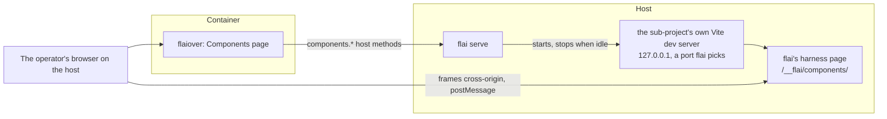

# The component library

The design of E-0026. The dashboard gets a Components page where the operator sees every component of their system, changes its props, and watches it follow changes to the design system and the source, live, without an IDE, a rebuild, or a redeploy. It takes up what [design-system-tool.md § The project's own components](design-system-tool.md#the-projects-own-components) left out of E-0020: rendering a project's components needs its own compiler and build, which only the host has.

The shape was settled on TH-0483. Each section names the story that builds it. The catalogue (S-0437), the dev server (S-0438), the Components page (S-0439), its controls for props (S-0440), live tokens (S-0441), a story's worktree (S-0442), examples (S-0443), flaiover's own components (S-0444), and examples' answers (S-0476) are built.

## How it fits together



The dashboard's container still holds nothing of the project ([ADR-0029](../adrs/0029-the-dashboard-reaches-a-project-only-through-flai-on-the-host.md), [ADR-0031](../adrs/0031-the-dashboard-s-container-holds-nothing-of-the-project-a-port-and-two-secrets.md)). flai on the host lists the components and runs the dev server. The page frames the dev server directly, which needs the operator's browser on the host.

## The catalogue (S-0437)

flai lists every component of a project's Svelte sub-projects and the props each takes, read with the project's own Svelte compiler ([ADR-0162](../adrs/0162-the-component-library-reaches-sub-projects-of-kind-sveltekit-or-svelte-finds.md)).

### Which sub-projects

A sub-project whose manifest `kind` is `sveltekit` or `svelte` is supported. `svelte` is a new kind, for a Svelte 5 app or library built with Vite but not SvelteKit. Every other sub-project is listed as unsupported, with its kind. Discovery, prop reading, and the harness sit behind a seam keyed by kind, so React and Vue can come later as adapters.

### The manifest key

A supported sub-project may carry `components`:

```yaml
projects:
  - name: flaiover
    path: flaiover
    kind: sveltekit
    components:
      include: ["src/lib/**/*.svelte"]   # default
      exclude: []                        # default
      setup: src/routes/layout.css       # default none
```

| Key | Default | Meaning |
|-----|---------|---------|
| `include` | `src/lib/**/*.svelte` | Globs, relative to the sub-project's folder, that find its components. The default leaves routes out. |
| `exclude` | none | Globs taken out of what `include` finds. |
| `setup` | none | A module of the sub-project the harness imports before any component, such as the app's stylesheet. |

The manifest's check reports a glob that does not parse, a `setup` that names no file, and `components` on a sub-project of an unsupported kind. [project-manifest.md](project-manifest.md) describes the key.

### Props

flai embeds a script, `props.mjs`, and runs it with the host's `node` in the sub-project's folder, so `svelte/compiler` is the sub-project's own installed copy. The script parses each component with the compiler's `parse` and the modern AST. A component is never imported or run to list it.

From the `$props()` destructuring it reads each prop's name, its default as written, whether it is required, and its TypeScript type as written. A local type alias, a local interface, or an inline object literal is resolved for its kind. An imported type is not: its kind is `unknown`, with its text kept.

Each prop in the catalogue has `name`, `kind`, `type`, `default`, `required`, `literals` for a union, and, since S-0449, `skeleton`.

| Kind | From a type such as |
|------|---------------------|
| `string` | `string` |
| `number` | `number` |
| `boolean` | `boolean` |
| `union` | `'sm' \| 'md' \| 'lg'`, with its literals |
| `array` | `string[]`, `Array<Item>` |
| `object` | an object literal, a local interface |
| `function` | `(id: string) => void` |
| `snippet` | `Snippet`, `Snippet<[Item]>` |
| `unknown` | an imported type, or anything else |

A component the compiler cannot parse is listed with its error. A missing `node`, or a sub-project without `svelte` installed, is an error that names what is missing and how to fix it.

#### Skeletons (S-0449)

A prop of kind `array`, `object`, or `unknown` carries a `skeleton`: an empty value of its type, as JSON. The props panel starts the prop's JSON editor with it ([Controls for props](#controls-for-props-s-0440)). No other prop has one. The operator chose this on TH-0515.

For the skeleton, the script resolves the prop's type whole, imported types included, with the sub-project's own `typescript` package, loaded from the sub-project as `svelte/compiler` is. It builds one TypeScript program for all of a run's components, with the sub-project's `tsconfig.json`, so path aliases such as SvelteKit's `$lib` resolve. Each component's scripts go into the program as a module beside the component's file. A SvelteKit sub-project whose options do not map `$lib`, such as a worktree where `.svelte-kit/tsconfig.json` is not generated yet, gets `$lib` mapped to `src/lib`. The prop's kind does not change: it is still read from the type as written.

| Type | Skeleton |
|------|----------|
| `string`, `number`, `boolean` | `""`, `0`, `false` |
| `Date` | `""` |
| A union of literals | Its first member |
| A union with `undefined` or `null` | The skeleton of the rest |
| Another union | Its first member's skeleton |
| An array | One element, the item's skeleton |
| A tuple | Each element's skeleton |
| An object or interface | Each property, optional ones included, with its skeleton. A function property is left out. |
| A `Record` or index signature without named properties | `{}` |
| A cycle, or more than six levels deep | `null` for an array, `{}` for an object |
| A type that cannot be resolved | `[]` for an `array` prop, `{}` for an `object` prop, `null` for an `unknown` prop |

A sub-project without `typescript` gives every such prop the last row's value. So does a type imported from a module that does not resolve. Inside a skeleton, a property whose type cannot be resolved is `null`. For `stories: Story[]`, with `Story` imported from `$lib`, the skeleton is one story with each field empty, such as `[{"id": "", "title": "", "points": 0}]`.

The program costs time. Listing flaiover's 58 components takes about 2.7 seconds with it, against about 0.4 seconds without it. Most of it is reading the type declarations the components' imports reach. So the script keeps what it resolved in a cache (S-0478, I-0166), under the checkout's `.flai-cache/component-props/<sub-project path>/`, one file per run's key:

- **Key.** The script's own hash, which flai passes it, the sub-project's folder, where its `typescript` resolves, and each typed component's scripts and the names of its props that take a skeleton. A run over other components, such as `flai check`'s examples rule beside the Components page's list, has a key of its own. The folder keeps the four files used last.
- **Stamps.** Each path TypeScript's system looked at while it resolved them, as it was before it looked: a file by its time and size; a missing file, as most of module resolution's probes are, by its folder's time, which a file made there changes; a folder asked to exist by whether it does; a folder listed by its time; a real path by what it resolves to. `typescript` itself is stamped too.
- **Hit.** A run whose key has a file and whose every stamp is as it was takes the skeletons from it, without loading `typescript`. Listing flaiover's components then takes about 0.45 seconds, of which checking about 6,300 stamps is a few tens of milliseconds.
- **Miss.** Any other run resolves them as above and writes its file, through a file of its own that it renames, so that a run beside it reads one or the other. A cache that cannot be written costs only the next run's time.

### Commands

- `flai components list [--project <name>] [--json]` prints the catalogue: each component's sub-project, path, and name, its props, and since S-0443 its examples ([In the catalogue](#in-the-catalogue)).
- `flai components config <sub-project> [--include] [--exclude] [--setup] [--unset]` writes the manifest key, keeping the manifest's other keys, order, and comments, and refuses a value the check reports. `flai manifest set` does not reach this key.

[flai-cli.md](flai-cli.md) describes both commands.

`flai guard` lets every agent run `flai components list`: every sub-agent, read-only ones among them, and the planner's, the orchestrator's, and the analyzer's own calls. No sub-agent and no strategic agent runs `flai components config`, which rewrites the manifest; it is the story's agent's (S-0477, [ADR-0186](../adrs/0186-flai-guard-lets-every-agent-run-flai-components-list-and-a-story-s-task-sub.md)).

## The dev server and its harness (S-0438)

flai runs a sub-project's own Vite dev server on the host, with the project's own config, plugins, and dependencies, so aliases, Tailwind, and the design stylesheet behave as in the app. A plugin flai embeds serves a harness page that renders one component by its path, inside an error boundary, after the `setup` module. Vite's hot module replacement carries each saved change, to the source or the stylesheet, into the harness.

[ADR-0163](../adrs/0163-flai-runs-a-sub-project-s-own-vite-dev-server-on-127-0-0-1-behind-the.md) records the decision. `internal/components` holds the harness and the dev server.

### The dev server

`flai components serve [--project <name>]` runs one in the foreground, in a shell ([flai.md § Render a component live](../../docs/users/flai.md#render-a-component-live)). `flai serve` runs the same one when the dashboard asks ([Under flai serve](#under-flai-serve)).

- The sub-project is the one `--project` names, of kind `sveltekit` or `svelte`. With no `--project`, it is the only such sub-project; with none, or more than one, the command is refused and says why.
- flai writes the harness into `.flai-cache/components/<project>/<sub-project>/`, again at every start: `plugin.mjs`, `harness.mjs`, `harness.html`, and a `vite.config.mjs`. The config loads the sub-project's own Vite config, the one Vite would find in its folder, with the sub-project's own Vite (`loadConfigFromFile`, so a TypeScript config works). It merges flai's plugin into it, with the sub-project's folder as Vite's root.
- flai runs `node_modules/.bin/vite --config <that config> --host 127.0.0.1 --port <free> --strictPort` in the sub-project's folder, in a process group of its own. It waits up to a minute for the harness page to answer 200.
- flai finds the free port by listening on port 0 and closing it, so another process can take the port before Vite binds it. Vite then exits saying the port is in use, and flai starts it again on another free port, three ports in all, before it gives up (S-0447, [I-0162](../issues/I-0162-the-components-dev-server-test-picks-a-free-port-and-closes-it-before-the-fake-vite-binds-it-so-a-concurrent-test-run-on-the-host-can-take-the-port-and-fail-the-integration-tier.md)). Vite takes a port number, not a listener, so the gap cannot be closed.
- A sub-project without `vite` in its `node_modules` is refused, naming the sub-project and the fix: `npm install` or `pnpm install` in its folder. A dev server that exits before it answers, or does not answer in time, is stopped, and the error carries its last lines of output.
- Stopping it ends its whole process group: SIGTERM, then SIGKILL five seconds later.

The dev server binds 127.0.0.1. The browser on the host frames it; the dashboard's container never reaches it.

A story's task sub-agent may run `flai components serve`, with or without `--story`, so that it can run a pass of the harness it wrote (S-0477, [ADR-0186](../adrs/0186-flai-guard-lets-every-agent-run-flai-components-list-and-a-story-s-task-sub.md)). `flai guard` refuses it to a read-only sub-agent, such as the explorer or the verifier, since serving writes the harness under `.flai-cache` and with `--story` may install the worktree's dependencies, which [ADR-0141](../adrs/0141-flai-guard-refuses-a-read-only-sub-agent-a-shell-command-that-writes-a-file.md) forbids it. It refuses it to the planner's, the orchestrator's, and the analyzer's own calls too.

### The harness

The harness at `/__flai/components/` imports the `setup` module, posts `ready`, and mounts the component a `select` message names, inside a `<svelte:boundary>`. Opened directly, with no `?origin=`, it mounts the component `?c=<path>` names instead. A component that throws, or fails to import, posts `error`; the next props or hot update renders it again.

- **Only what the page selects (S-0449).** Framed, with `?origin=`, the harness does not mount `?c=`. The page sends `select` on every `ready`, so a frame that reloads shows the component the page has picked, not the one its URL first named. A `props` message that comes while a `select` is still importing its component is kept, and the component mounts with it.
- **Nothing of the component before.** A `select` unmounts the component, then empties `#flai-component` and removes from the body whatever was added to it after the `setup` module ran, such as a portal. What a mount that threw had rendered goes with it.
- **The app's own requests (S-0449).** Framed, the harness answers a component's requests to the app's own server itself, so none reaches the dev server's server code, which would answer 500 with no dashboard token and no host channel ([ADR-0172](../adrs/0172-the-component-harness-answers-a-framed-component-s-requests-to-the-app-s-own.md)). It replaces `fetch`, `EventSource`, and `WebSocket` before the `setup` module runs. A request is the app's when it goes to the dev server's origin and is none of these: a path under `/@`, `/__`, or `/node_modules/`, Vite's ping, or a path whose last segment has a file extension, such as a module or an asset. A `fetch` of the app's is answered 501 Not Implemented, with a JSON body `{"error": "flai's component harness does not answer the app's own requests: <METHOD> <path>"}`. An `EventSource` of the app's opens no connection: it fires `error` and is closed. A `WebSocket` is the app's by the same rule, its `ws:` or `wss:` read as `http:` or `https:`, unless it asks for one of Vite's own subprotocols, such as `vite-hmr` or `vite-ping`, which Vite's client opens on the base path, so that hot updates still reach the harness ([ADR-0182](../adrs/0182-the-dashboard-s-live-events-reach-the-browser-over-a-websocket.md)). A `WebSocket` of the app's opens no connection either: it fires `error`, then `close` with code 1006 and `wasClean` false, as a refused one does, and is closed. Each posts an `event` of the component last selected, named `fetch` with the method, the path, and the status it got, or `EventSource` with the path and 200 or 501, or `WebSocket` with the path, each path with its query. Every other request goes through, as does every request when the harness is opened directly. `XMLHttpRequest`, `sendBeacon`, and a form's submission are not covered; no flaiover component uses them.
- **Answered from the example (S-0476).** A `fetch` or an `EventSource` of the app's that one of the answers the last `select` or `props` message carried matches is answered from it instead ([Answers](#answers), [ADR-0187](../adrs/0187-an-example-may-carry-the-answers-the-component-harness-gives-a-framed-component.md)). The `fetch` resolves, after the current task, with a `Response` of the answer's status, headers, and body, and its `event` carries that status. The `EventSource` opens no connection: after the current task it fires `open`, with `readyState` 1, then a `MessageEvent` for each of the answer's events, of its `event` name, `data`, and `lastEventId`, each in a task of its own, and stays open until the component closes it; its `event` carries 200. A `WebSocket` is never answered from an example.
- **The margin.** `#flai-component` has 10px of padding, and the body none, so the component sits 10px from each edge of the frame.
- **SvelteKit.** The plugin adds its middleware directly in `configureServer`, not in a hook it returns, so the harness page is answered before SvelteKit's router, which answers every other path.
- **Virtual modules.** The page's script, the error boundary (`Frame.svelte`), and the catalogue are modules no file backs: `virtual:flai-components/harness.mjs`, `virtual:flai-components/Frame.svelte`, and `virtual:flai-components`. So `svelte` and every other import resolve from the sub-project, not from `.flai-cache`. The catalogue maps each component's path to a function that imports it, found as `flai components list` finds them.
- **Its own optimizer cache.** The harness's dependencies are optimized into `node_modules/.vite-flai-components` in the sub-project, not Vite's own cache. So the harness and the app's own dev server do not each make the other optimize them again.
- **No error overlay.** Vite's overlay would cover the frame, so the plugin turns it off; the harness posts `error`, and the page shows it.
- **Changes.** A saved change reaches the harness as a hot update, after which it renders the component again and posts `rendered`. A component added or removed while the dev server runs reloads the page, so the page sends `select` again on each `ready`.
- **Its size.** The harness posts `size` for everything the component draws, with the 10px margin on each side. That is the union of `#flai-component`'s box and the box of every element in it, or in what it added to the body, `fixed` and `absolute` ones among them, so a dialog is framed whole ([I-0160](../issues/I-0160-the-components-page-frames-a-component-that-draws-a-fixed-overlay-such-as-a-dialog-at-160px-as-its-content-s-height-is-0-cutting-the-dialog-off.md)). A `fixed` element pinned to the viewport's top and bottom, such as a dialog's backdrop or a drawer, grows with the frame, so its own box is left out; what it holds counts. Content above the top margin, such as a centred dialog taller than the frame, adds as much again, so the frame grows until the dialog fits. A frame taller than a centred dialog shrinks back, each size halving the room left over, to the dialog and its margins. When the content is wider than the frame, the height adds the horizontal scroll bar's. The harness measures again when the frame is resized, when anything in the body changes, and when `#flai-component` resizes, and posts only a size that changed. While a `select` imports its component, the last size stands.
- **Where an error is.** A compile error's `file`, `line`, and `column` are the source's, from Vite. A runtime error's are the first frame of its stack in the sub-project's own code, outside `node_modules`, so its line is the compiled JavaScript's, not the source's.

### Under flai serve

Starting a dev server runs the project's code on the host, so it sits behind the host action `components`, off until the operator runs `flai serve enable components` ([the components host action](../../docs/operators/index.md#the-components-host-action-s-0438)). `components.start` and `components.stop` are gated by it and journalled; `components.status` and `components.list` are reads. [dashboard-host-channel.md](dashboard-host-channel.md#decision) gives each method's params and answer. Each takes the sub-project as `sub_project`, never `project`, which is the channel's project key alone, on every call (S-0448, [I-0163](../issues/I-0163-the-components-page-cannot-list-start-or-stop-anything-through-the-dashboard-because-the-channel-s-project-key-and-the-components-methods-sub-project-share-the-one-params-field-project.md)).

- `flai serve` supervises one dev server per project, sub-project, and source: the main checkout or a story's worktree ([Sources](#sources)). A second start answers the one that runs, or waits for the one starting.
- It stops a dev server that had no `components.status` for `components.idle`, a host setting of 30 minutes by default (`flai serve components idle <duration>`). It looks every tenth of that, but no more often than every second and no less often than every minute, and reads the setting at every look, so a change applies without a restart.
- It stops every dev server when it stops.
- A dev server that fails to start, or exits on its own, is dropped, and why is kept as the sub-project's `last_error` until one starts again.
- Vite's output is dropped; `flai serve`'s log records each start, stop, and exit.

### The protocol

The dashboard frames the harness cross-origin and talks to it by `postMessage`. Every message is an object with `source: "flai-components"`, `version: 1`, and `type`. The harness URL carries the page's origin as `?origin=`: the harness accepts messages only from that origin and posts only to it, and the page accepts messages only from the harness's origin and its own frame. Without `origin`, the harness renders `?c=` and posts nothing; with it, the harness renders only what `select` names.

| From | Type | Fields | Meaning |
|------|------|--------|---------|
| page | `select` | `component`, `props?`, `functions?`, `snippets?`, `answers?` | Mount this component, by its path in the sub-project, with these props. |
| page | `props` | `props`, `functions?`, `snippets?`, `answers?` | Set the mounted component's props without remounting it. Each name in `functions` gets a logger that posts `event`; each name in `snippets` with a string value is rendered as a snippet of that text. `answers` are what the harness answers the app's requests with ([Answers](#answers)). |
| page | `theme` | `theme` | Set `data-theme` on the document to `light` or `dark`. |
| page | `tokens` | `light`, `dark` | Lay these CSS custom properties over the stylesheet's, under `:root` and `[data-theme='dark']`, in place of the last message's; empty objects clear them. |
| harness | `ready` | `component?` | The harness has loaded and its `setup` module has run. |
| harness | `rendered` | `component` | The component mounted, or took new props. |
| harness | `error` | `component`, `message`, `file?`, `line?`, `column?` | The component failed to import or render; `file` and `line` say where. |
| harness | `event` | `component`, `name`, `args` | A function prop was called, with its arguments as far as JSON carries them. Named `fetch`, `EventSource`, or `WebSocket`, the harness answered a request to the app's own server ([The harness](#the-harness)). |
| harness | `size` | `width`, `height` | The size of all the component draws, a fixed dialog among it, with the 10px margin on each side, in CSS pixels, each time it changes ([Its size](#the-harness)). |

`select` takes `functions` and `snippets` as `props` does, so that a component that calls a function prop, or renders a snippet, as it mounts already has it. ADR-0163's table names `functions` on `props` only, and `snippets` nowhere; S-0440 added them.

- **A props message is whole.** It carries every prop the page sets, not a change. The harness spreads them over the mounted component, which takes them in place, without a remount, and keeps its own state. A prop left out falls back to its default.
- **Answers are whole too (S-0476).** A `select` or `props` message's `answers` replace the last message's, for the requests made after it; a message without them leaves none, so every request of the app's gets 501. An `answers` that is not an array is taken as none. The harness reads each answer as the check would have it ([Answers](#answers)) and passes over one it cannot use, such as one without a `path`.
- **Loggers.** Each name in `functions` is given a logger. A call posts `event` with the component, the prop's name, and each argument as JSON, or as far as JSON carries it: an Event as `{type, detail?}`, a DOM node as `<tag>`, a function as `[function name]` or `[function anonymous]`, and a cycle cut off.
- **Snippets.** Each name in `snippets` whose value is a string is rendered as a snippet of that text, made with Svelte's `createRawSnippet`: a `<span>` holding the text as text, not markup. A listed name without a string value is passed as it is; a string not listed is passed as a plain string.
- **Identity.** Loggers and snippets keep their identity between props messages: a logger is the same function each time, and a snippet the same while its text is.
- **Tokens (S-0441).** A tokens message is whole, as a props message is. The harness writes it into one `<style data-flai-tokens>`: `:root { … }` for `light`, then `[data-theme='dark'] { … }` for `dark`, the selectors `flai design css` writes ([ADR-0159](../adrs/0159-the-generated-design-stylesheet-puts-the-dark-values-under-data-theme-dark-and.md)). It appends the element to the head, so it wins over the project's stylesheet by order at equal specificity. A `MutationObserver` on the head moves it back to the end when a `<style>` or a stylesheet `<link>` lands after it, such as a lazily imported component's styles. A name is taken with or without its leading `--`.
- **Refused values.** A name that is not letters, digits, `_`, and `-`, a value that is not a string or a number, and a value holding `url(`, a brace, `;`, `<`, `@`, a backslash, or `/*` are left out, as the Design page's preview refuses them ([ADR-0149](../adrs/0149-the-design-page-previews-a-project-s-tokens-in-a-blank-same-origin-frame-it.md)). A message whose `light` or `dark` is not an object is dropped, and the last one stays. A message that leaves nothing to lay, such as empty objects, removes the element.

## The Components page (S-0439)

The dashboard's Components page lists every component of the project and renders the one the operator picks, live, from the project's own dev server. It is the second page of the Design group. It lists the catalogue by sub-project and folder, with a filter, and lists unsupported sub-projects with their kind. Picking a component frames the harness, in light and dark and at chosen widths. The page starts the dev server on request, keeps it alive while open, says how to enable the host action when it is off, and shows the harness's error, with the file and line, when a component fails to render.

## Controls for props (S-0440)

The operator changes a component's props on the Components page, a control for each from its kind in the catalogue, and sees it render as they change. Each change reaches the harness without remounting the component, so it keeps its own state, and the props are kept in the page's URL. [flaiover-dashboard.md § The Components page](flaiover-dashboard.md#the-components-page-s-0439) gives the page's components and its URL; [the user guide](../../docs/users/flaiover.md#components) says what the operator sees.

| Kind | Control | Sent as |
|------|---------|---------|
| `string` | A text input | The text; emptied, the empty string |
| `number` | A number input | A number |
| `boolean` | A checkbox, unset until it is clicked | `true` or `false` |
| `union` | A select of its literals, with "(not set)" | The literal's value |
| `array`, `object`, `unknown` | A JSON editor | Any valid JSON |
| `snippet` | Text | The text, named in `snippets`, so the harness renders it as the snippet |
| `function` | None | Left out, named in `functions`, so the harness gives it a logger |

- **Defaults.** A control starts at its prop's default when the source writes the default as a literal: a string, a number, a boolean, `null`, or an array or object literal of them. Any other default, such as a call or a name, leaves the control empty, and the component's own default applies. A JSON editor is the exception: without a literal default, it starts at its prop's skeleton ([Skeletons](#skeletons-s-0449)), so the component's own default does not apply (TH-0515). A literal default still wins over the skeleton. Reset puts every control back to its default, and a JSON editor without a literal default back to its skeleton.
- **Text that does not parse.** Each control keeps what the operator types. Text that does not parse, such as invalid JSON, is shown with its error. While any text does not parse, nothing is sent and the URL is not written.
- **What is sent.** Every prop with a value, together: a `select` when a component is picked, a `props` message when only the props change, and nothing when they are the same as last sent. A prop without a value is left out and takes its default. A JSON editor's skeleton is a value, so it is sent: what the field shows is what the component gets (TH-0515).
- **Required props.** Svelte does not enforce a required prop at runtime, so the page does. A required prop without a value is marked, and the page shows which props need one in the frame's place until each has a value. This is the page's notice, not a harness error: the props are still sent meanwhile, and the frame stays loaded, hidden.
- **Calls.** Each function prop's calls come back as `event`. The page lists the last 50, newest first, and empties the list when another component is picked.
- **Links.** The props' values are kept in the URL, so a link opened in another tab renders the component with the same props. Picking another component drops them.

## Live tokens (S-0441)

A token change on the Design page reaches the components on the Components page, as the operator tries it and once it is saved. A saved token rewrites the generated stylesheet (S-0436, [ADR-0150](../adrs/0150-a-token-save-from-the-design-page-lands-on-main-and-flai-writes-the-stylesheet.md)), and the dev server's hot update carries it into the frame. A tried, unsaved value is kept in the browser and sent to the harness, which lays it over the stylesheet's variables under the same names and theme selector as `flai design css` writes ([ADR-0159](../adrs/0159-the-generated-design-stylesheet-puts-the-dark-values-under-data-theme-dark-and.md)).

- **Tried.** The Design page keeps its unsaved edits in the browser's `localStorage`, per project, as a draft. The Components page reads the draft, and follows it from another tab by the `storage` event. While there is one, it reads the saved design system, lays the draft over the saved themes as the Design page does, and sends each frame the custom properties the generated stylesheet would carry for them, every one, light and dark, as a `tokens` message. The harness lays them over the stylesheet's ([The protocol](#the-protocol)). The page says it shows tried tokens, with **Drop tried tokens**, which clears the draft and sends an empty `tokens` message.
- **Saved.** The save needs nothing of the Components page. It writes the token file and the stylesheet in one commit, the sub-project's dev server sees the stylesheet change, and its hot update replaces the stylesheet in the harness without a reload. The save also clears the draft, so the page drops the tried tokens and the saved values show. The stylesheet reaches the harness only through the sub-project's own imports, such as its `setup` module.
- **A tried value wins** over the stylesheet while the draft lasts: the tokens element stays last in the head after a hot update too. It carries every token, so the page reads the saved tokens beneath the draft again on each `document` change.

[flaiover-dashboard.md § The Components page](flaiover-dashboard.md#the-components-page-s-0439) gives the page's modules; [the user guide](../../docs/users/flaiover.md#tried-and-saved-tokens) says what the operator sees.

## A story's worktree (S-0442)

The Components page renders a story's worktree, so the operator sees a component an agent is changing live while the story is in progress or in review. The page offers a source: the main checkout, or a story. For a story, flai runs a second dev server in the story's worktree on its own port, and stops it when the story leaves review. The components its branch changes are listed first, and the review page links to them.

### Sources

- **A story's methods.** `components.list`, `components.status`, `components.start`, and `components.stop` take an optional `story`. With one, the catalogue is read with the worktree's own manifest from the worktree, so a component the branch adds is listed, and the dev servers are that story's; each answers `story` beside `project`. A story that is not a work item, is not a story, is not in progress or in review, or has no worktree is refused, as [ADR-0145](../adrs/0145-a-dashboard-save-may-name-a-story-and-is-then-committed-on-that-story-s-branch.md) refuses a save to one. `flai components serve --story S-nnnn` runs the same dev server in a shell.
- **Its own dev server.** `flai serve` keeps one dev server per project, sub-project, and source, each on a port of its own. A story's runs from the sub-project's folder in the worktree, with the harness under the worktree's own `.flai-cache/components/`.
- **The install step.** A worktree is a fresh checkout without `node_modules`. When the sub-project's `vite` is missing there, flai first installs the dependencies by the first lock file it finds in the sub-project's folder, then in each folder above it up to the worktree's root: `pnpm install --frozen-lockfile` for `pnpm-lock.yaml`, `npm ci` for `package-lock.json`, `yarn install --frozen-lockfile` for `yarn.lock`, run where the lock file is, for at most ten minutes. A failed install is the start's error, with the command and its last lines. No lock file, a package manager missing from `PATH`, or `vite` still missing after the install is refused with the fix. The main checkout is never installed into.
- **The cap.** At most `components.max_servers` dev servers run or start at once per project, main's and every story's together, 3 by default (`flai serve components max-servers <n>`). A start beyond it is refused by rule, naming the ones running; a start answered by one that runs is not.
- **Leaving review.** `flai serve` looks every five seconds at each story whose dev server runs. It stops the server when the story has left review since the server started, to done, cancelled, or back to in-progress, and when the story is no longer in progress or in review at all. A story that moves from in-progress to review keeps its server. The idle stop applies to a story's server as to main's.
- **The page.** The source picker offers Main and the stories in progress or in review, from the board, and keeps the choice in the URL as `?story=`. With a story picked, the catalogue, the dev server, and the frame are the worktree's. The paths the branch changes come from `stream.diff`; `$lib/explorer/changed.ts` matches them against the catalogue's files, and the components they change are listed first under the picker, marked, and marked and first in their folder in the list.
- **The review link.** The review page reads the worktree's catalogue for a story in progress or in review. When the branch changes a component, it names them under **Changes on the branch** with **Open in Components**, which opens the page with the story picked. A catalogue that cannot be read offers nothing.

## Examples (S-0443)

A component's examples are kept under design/components, chosen on the Components page, and kept in step with its props by flai check. An example is a named set of props, for a component that renders only with data. The page lists them, loads one into the props panel, and saves a new one on main or on the story it shows. [ADR-0164](../adrs/0164-a-component-s-examples-are-named-sets-of-props-in-one-json-file-per-component.md) records the decision, on TH-0483's answer 4, and [design/components/README.md](../components/README.md) says what the folder holds. `internal/components` (`examples.go`) finds, parses, and validates the files.

### The file

Each component's examples are one file, `design/components/<sub-project>/<path>`: the sub-project's manifest `name`, then the component's path in the sub-project with `.svelte` replaced by `.examples.json`. `flaiover/src/lib/components/Card.svelte` has its examples in `design/components/flaiover/src/lib/components/Card.examples.json`. Mirroring the path keeps two components of one name apart, and finds the file from the component.

The file is JSON, an exception to "Everything is markdown" as the token file is ([documentation.md](../conventions/documentation.md)). It holds `examples`, an array in the order the page lists them, and nothing else. Each example has these keys and no others:

| Key | Type | Required | Meaning |
|-----|------|----------|---------|
| `name` | string, not empty | yes | Names the example; unique in its file. |
| `props` | object, prop name to JSON value | yes, may be `{}` | The props, as the panel sends them ([Controls for props](#controls-for-props-s-0440)): a snippet's text, no function prop. |
| `theme` | `"light"` or `"dark"` | no | The one theme the page shows. Absent, the page keeps what it shows. |
| `width` | integer, 1 or more | no | The frame's width in CSS pixels. Absent, the page keeps what it shows. |
| `answers` | array of answers | no | What the harness answers the component's requests to the app's own server with, since S-0476 ([Answers](#answers)). Absent, every such request gets the harness's 501. |

```json
{
  "examples": [
    {
      "name": "A long title",
      "props": { "title": "Quarterly report for the north region", "open": true },
      "theme": "dark",
      "width": 375
    }
  ]
}
```

The page writes the file with two-space indentation and a final newline. It writes `theme` when it shows one theme, not both, `width` when a width is picked, not the panel's own, and `answers` when the example has any.

#### Answers

An example's `answers` let a component that asks the app's server be shown in its answered state ([ADR-0187](../adrs/0187-an-example-may-carry-the-answers-the-component-harness-gives-a-framed-component.md), refining ADR-0172). The harness answers a framed component's `fetch` or `EventSource` to the app's own server from them ([The harness](#the-harness)). Each answer has these keys and no others:

| Key | Type | Required | Meaning |
|-----|------|----------|---------|
| `path` | string starting with `/` | yes | The request's path, with its query when the answer is for that query alone. |
| `method` | string, an HTTP method | no | Compared without case. Absent, the answer matches every method. |
| `status` | integer, 200 to 599 | no | The fetch's status, 200 when absent. |
| `headers` | object, name to string | no | The fetch's response headers. |
| `body` | any JSON value | no | The fetch's body: a string as it is, with `content-type: text/plain; charset=utf-8`, anything else as JSON, with `content-type: application/json`, unless `headers` names a `content-type`. Absent, the body is empty, as it must be with status 204, 205, or 304. |
| `events` | array of `{event?, data, id?}` | no | Makes it an `EventSource`'s answer: the messages it sends, in order. `data` is sent as it is when a string, as JSON otherwise; `event` absent is `message`. It takes no `status`, `headers`, or `body`, and no `method` but `GET`. |

- **Which answer.** A `fetch` matches the answers without `events`, an `EventSource` those with them. Of those, the first in the example's order whose `method` matches and whose `path` is the request's path with its query wins; when none is, the first whose `path` has no query and is the request's path without it.
- **None matches.** The request gets the harness's answer of ADR-0172, a 501 or an `error`.
- **Fixtures.** Answers are not checked against the app's routes. A story that changes what a route answers changes the examples that copy it, as one that changes a component's props changes its examples ([design/components/README.md](../components/README.md)).

```json
{
  "name": "No threads, and a resolve refused",
  "props": { "on": "S-0001" },
  "answers": [
    { "path": "/api/threads?on=S-0001", "body": [] },
    { "path": "/api/threads/TH-0002/resolve", "method": "POST", "status": 409, "body": { "error": "TH-0002 is resolved already" } },
    { "path": "/api/stream", "events": [{ "event": "change", "data": { "kind": "edited" } }] }
  ]
}
```

### In the catalogue

`components.list` and `flai components list --json` give each component of a supported sub-project two more fields:

| Field | Holds |
|-------|-------|
| `examples` | Its file's examples, in the file's order; `[]` when it has no file |
| `examples_path` | Its file's path in the repository, given whether or not the file exists, so the page knows where a first example goes |

Each example is as the file has it, `answers` among its keys when it has them. A file that does not fit the format gives the examples that parsed, with `props` `{}` where they are not an object, and `answers` left out where they are not an array; `flai check` reports what does not fit. A file that cannot be read fails the list. The text output adds `(N examples)` after a component that has any. Reading examples needs no `node`.

### Saving one

The page saves through `file.save`, on main or on the story its source names. `design/components/` is under the design folder, so [ADR-0147](../adrs/0147-the-dashboard-reads-and-saves-a-text-file-that-is-not-markdown-through-file-get.md)'s reach is unchanged. A component's first example creates its file: a save with an empty hash creates a file that is absent, with its folders, and an empty hash on a file that exists is refused as a conflict, with its current content and hash. The check runs before and after as for any save, so an example that does not fit its component is refused with the finding; a refused create leaves no file and no folder behind.

### On the page

The Components page lists the picked component's examples above the props panel. Choosing one loads its props into the panel, and its theme and width when it gives them; the URL follows, as for any change of props. **Save as example** asks for a name, starting from the example last chosen, says when the name is one the file has, and saves the panel's props as that example, with the theme and width as [The file](#the-file) says. An example of the same name is replaced in its place; a new one goes last. The save goes on main, or on the story the source picker names ([Sources](#sources)). A conflict or a refusal is shown with flai's words and its findings, and the name and the panel's values are kept. **Save as example** is offered only when the catalogue gives `examples_path`.

**Answers (S-0476).** Under the examples, an **Answers** panel holds the answers the page sends the harness, as a JSON editor of the array ([Answers](#answers)). Choosing an example loads its answers, or empties the panel when it has none; picking another component empties it. The page sends the answers with every `select` and `props` message, so an edit reaches the harness at once, for the requests the component makes after it. Text that does not parse, or is not an array, is shown with its error, and the answers are not sent meanwhile: the page goes on sending the last answers that parsed, with any change of props. The answers are not kept in the URL, since they can be large. **Save as example** saves the panel's answers with the props, and leaves `answers` out when the panel is empty.

The page saves through `PUT /api/components/examples`. The route finds the file by `examples_path` in `components.list` for the source. When the catalogue gives the component examples, it reads the file and its hash with `file.get` and saves with that hash. When it gives none, it creates the file with an empty hash; if the file exists after all, flai's conflict gives its content and hash, and the route adds the example to that and saves once more. [flaiover-dashboard.md § API](flaiover-dashboard.md#api-s-0011) gives its answers.

### The check

`flai check` reports `components.examples`, a warning, which `flai check --strict` fails on, for:

- a file that does not parse as JSON or does not fit the format: a key it does not name, an empty or repeated `name`, `props` that is not an object, a `theme` that is not `light` or `dark`, a `width` that is not a positive integer;
- an `answers` that does not fit [Answers](#answers): not an array, an answer that is not an object or has a key the table does not name, a `path` missing or not starting with `/`, a `method` that is not an HTTP method's letters, a `status` that is not an integer from 200 to 599, `headers` that are not an object of strings, a `body` with status 204, 205, or 304, `events` that are not an array of objects with `data` and only a string `event` and `id` beside it, or `events` with `status`, `headers`, `body`, or a `method` other than `GET`;
- an example that names a prop its component lacks, misses a required prop that is not a function, or gives a value that does not fit its prop's kind;
- a file whose component does not exist: no supported sub-project of that name, or no component at that path in its catalogue;
- a file whose component's props flai could not read for any other reason, once, with the reader's error.

Each finding names the example and its line: the prop's key for a finding about one prop, the example's opening brace for one about the example, the syntax error for JSON that does not parse, and line 1 for a file without its component.

| Kind | A value that fits |
|------|-------------------|
| `string`, `snippet` | a string |
| `number` | a number |
| `boolean` | `true` or `false` |
| `union` | one of its literals |
| `array` | an array |
| `object` | an object |
| `unknown` | any value |
| `function` | none; the page gives it a logger |

`null` fits every kind but `function`: flai leaves `null` out of a type when it reads its kind ([Props](#props)), so the kind cannot say whether `null` is allowed.

The check reads only files ending in `.examples.json`, and runs the props reader only for the components that have one. A project without such a file gets no finding. A project that has one but no supported sub-project, or a host without `node`, is passed over with one note: a warning `flai check --strict` passes over, saying what was not checked and why. Without `node`, the format and whether each file's component exists are still checked; only the props are not. A sub-project whose svelte is not installed, such as one in a story's worktree without its `node_modules`, is passed over with one note too, on its examples folder `design/components/<sub-project>`, saying to install it ([ADR-0171](../adrs/0171-a-sub-project-whose-svelte-is-not-installed-gets-one-components-examples-note.md)). Its files' format and components are still checked.

## flaiover's own components (S-0444)

This repository uses its own component library on flaiover, a real SvelteKit app, so the library is proven beyond its fixture. Every component the catalogue lists renders in the harness without an `error`, in light and dark, from its defaults or from an example.

### The setup and what is left out

flaiover's manifest entry, written with `flai components config`, names its setup and leaves out what only the app can fill:

```yaml
- name: flaiover
  path: flaiover
  kind: sveltekit
  components:
    exclude: [src/lib/components/AgentStream.svelte, …]
    setup: src/routes/layout.css
```

The setup is the app's own stylesheet: Tailwind, the typography plugin, the app's palette as custom properties for light and dark, and the `dark` variant on `[data-theme='dark']`, so the harness's `theme` message switches a component as the app's toggle does.

A component is left out when everything it shows comes from the app's server or its app-wide stores, so that in the harness it shows only an empty frame or the server's error, whatever its props. A component with markup of its own beside a fetch that fails, such as AcceptConfirm or Threads, is listed.

| Component | Why it is left out |
|-----------|--------------------|
| EditorDialog, HostFlai, HostFlaiBanner, InboxBadge, UnsignedBanner | It takes no props and shows only what an app-wide store holds (`editorState`, `hostFlai`, `projectState`, `inboxState`). The app's layout fills the store from the host channel, and the harness never does, so it renders nothing. |
| OpenQuestions | It lists only the questions in the app-wide `inboxState`, so it shows an empty list whatever its props. |
| DocEditor, ItemEditor, Review | It loads the document or item its one prop names from `/api` before it shows anything, so the harness shows only the server's error. |
| SettingsPanel, HostPanel, HostProcesses | It shows only the settings it loads from `/api`, so the harness shows only "Loading…" or the server's error. |
| AgentStream | It shows only the entries `/api` streams, so it shows an empty box. The panels that embed it are listed. |
| HostAgentNotice, PlanAction, StoryAgent | It shows only what `/api/host-agent` or `/api/items/<id>/plan` answers, so it renders nothing. |

That leaves 53 of flaiover's 69 components listed.

### Its examples

Each listed component that has a required prop, or whose defaults show nothing, has an examples file under `design/components/flaiover/` ([Examples](#examples-s-0443)): 55 files, Messages' and Threads' among them since S-0476, each with at least one example that renders its main state from data shaped as the app's own types. The examples leave `theme` out, so the page shows both themes, except one of Chart's, whose `theme` prop fixes the chart's palette. ComponentFrame's examples frame `http://127.0.0.1:5173/__flai/components/`, Vite's default port, since flai picks the dev server's port at each start: the frame loads only where a dev server answers there. The design components' examples carry every token of this repository's design system, as the Design page passes them, so they are the largest files, up to 148 KB as the page indents them; `components.list` carries them all.

### The test

`flai/internal/components/flaiover_test.go`, in the integration tier, serves a copy of flaiover with the components key `system-flow.yaml` gives it, its `node_modules` linked to the installed one. It asks the dev server for the setup and for each listed component's module, as the harness imports them. A component that does not compile, or imports what does not resolve, is answered with Vite's error, and fails the test with its path; a broken component the test writes into the copy is its control. It skips under `-short`, without `node`, and without flaiover's dependencies installed.

### What the pass found

A headless pass rendered every listed component's examples, or its defaults, in the harness the Components page frames, in light and dark: 161 renders, none with an `error`. A second pass, in S-0449, rendered the 54 components then listed, 167 renders, none with an `error`, and clicked each enabled button once, 182 clicks. No response was 500 or more. The harness answered the requests of AcceptConfirm, ActivityView, AnalyzerPanel, CancelConfirm, ImportPrompt, InboxView, Messages, NewAdrForm, NewItemForm, OrchestratorPanel, PlannerPanel, PublishBanner, Threads, and WorktreeUncommitted. What renders wrongly, or not as in the app:

- **Requests to the app's own server.** The harness is served by flaiover's own dev server, so a component's `/api` fetch reached flaiover's server, which answered 500 without the dashboard's token and has no host channel. AcceptConfirm, CancelConfirm, ImportPrompt, Messages, NewAdrForm, NewItemForm, and the stream inside ActivityView, PlannerPanel, OrchestratorPanel, and AnalyzerPanel showed "Internal Server Error", or an empty select where the answer would fill one. Threads said "No threads here." Since S-0449 the harness answers those requests itself, with 501 and an error that names the request, and the page's event log lists each ([The harness](#the-harness)). A component that shows a request's `error`, as these do, shows the harness's in place of "Internal Server Error". Since S-0476 an example's answers give the harness what to answer instead ([Answers](#answers), [I-0164](../issues/I-0164-the-components-page-cannot-show-a-component-that-asks-the-app-s-server-in-its-answered-state-since-the-harness-answers-every-such-request-with-501.md)). Each of the fourteen has an example with answers copied from its routes' shapes; Messages and Threads have their first examples file. A third pass rendered their 17 answered examples in light: none with an `error`, every request answered from the example with the answer's status, none 501, and each showing the answer's data, such as Threads' first thread and the panels' stream entries. What answers cannot show: a `WebSocket`, such as Messages' and Threads' follow of `/api/events`, stays unanswered; an answer is the same each time, so a list read again after a write, such as Threads' after a reply, shows what it showed before; and an answer that names an ID, such as a new item's, answers that ID alone.
- **Dialogs.** A dialog draws a fixed overlay, so the harness reports its content's height as 0, and the page frames it at 160 pixels, cutting off one taller than that ([I-0160](../issues/I-0160-the-components-page-frames-a-component-that-draws-a-fixed-overlay-such-as-a-dialog-at-160px-as-its-content-s-height-is-0-cutting-the-dialog-off.md)). Since S-0449 the harness measures what a dialog draws, so the frame holds it whole ([The harness](#the-harness)).
- **TokenEditor.** It sets `data-theme` on each value cell, so the other theme's hex fields are dark text on a dark field, on the Design page as in the harness ([I-0159](../issues/I-0159-tokeneditor-sets-data-theme-on-each-value-cell-so-the-other-theme-s-hex-fields-are-dark-text-on-a-dark-field-and-cannot-be-read.md)). Since S-0474 a cell carries `data-cell-theme`, which no stylesheet reads, so the page's theme styles every cell, and a test fails while any element in the editor carries `data-theme`.
- **CardReorder** shows nothing: its buttons appear only while a parent with Tailwind's `group` class is hovered or focused, and the harness gives it none.
- **Gallery** outside PreviewFrame has no `gallery.css`, so its success and warning alerts have no colour of their own.
- **StrategicAgentPanel** cannot show a run in progress: a running run calls its `stream` prop, and the harness's logger answers `undefined`. PlannerPanel, OrchestratorPanel, and AnalyzerPanel, which pass a real `stream`, show it.
