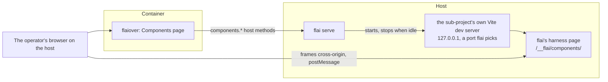

# The component library

The design of E-0026. The dashboard gets a Components page where the operator sees every component of their system, changes its props, and watches it follow changes to the design system and the source, live, without an IDE, a rebuild, or a redeploy. It takes up what [design-system-tool.md § The project's own components](design-system-tool.md#the-projects-own-components) left out of E-0020: rendering a project's components needs its own compiler and build, which only the host has.

The shape was settled on TH-0483. Each section names the story that builds it. The catalogue (S-0437), the dev server (S-0438), the Components page (S-0439), and its controls for props (S-0440) are built. The sections after them say what is decided and is to be built, and each story brings its section up to date as it lands.

## How it fits together



The dashboard's container still holds nothing of the project ([ADR-0029](../adrs/0029-the-dashboard-reaches-a-project-only-through-flai-on-the-host.md), [ADR-0031](../adrs/0031-the-dashboard-s-container-holds-nothing-of-the-project-a-port-and-two-secrets.md)). flai on the host lists the components and runs the dev server. The page frames the dev server directly, which needs the operator's browser on the host.

## The catalogue (S-0437)

flai lists every component of a project's Svelte sub-projects and the props each takes, read with the project's own Svelte compiler ([ADR-0162](../adrs/0162-the-component-library-reaches-sub-projects-of-kind-sveltekit-or-svelte-finds.md)).

### Which sub-projects

A sub-project whose manifest `kind` is `sveltekit` or `svelte` is supported. `svelte` is a new kind, for a Svelte 5 app or library built with Vite but not SvelteKit. Every other sub-project is listed as unsupported, with its kind. Discovery, prop reading, and the harness sit behind a seam keyed by kind, so React and Vue can come later as adapters.

### The manifest key

A supported sub-project may carry `components`:

```yaml
projects:
  - name: flaiover
    path: flaiover
    kind: sveltekit
    components:
      include: ["src/lib/**/*.svelte"]   # default
      exclude: []                        # default
      setup: src/routes/layout.css       # default none
```

| Key | Default | Meaning |
|-----|---------|---------|
| `include` | `src/lib/**/*.svelte` | Globs, relative to the sub-project's folder, that find its components. The default leaves routes out. |
| `exclude` | none | Globs taken out of what `include` finds. |
| `setup` | none | A module of the sub-project the harness imports before any component, such as the app's stylesheet. |

The manifest's check reports a glob that does not parse, a `setup` that names no file, and `components` on a sub-project of an unsupported kind. [project-manifest.md](project-manifest.md) describes the key.

### Props

flai embeds a script, `props.mjs`, and runs it with the host's `node` in the sub-project's folder, so `svelte/compiler` is the sub-project's own installed copy. The script parses each component with the compiler's `parse` and the modern AST. A component is never imported or run to list it.

From the `$props()` destructuring it reads each prop's name, its default as written, whether it is required, and its TypeScript type as written. A local type alias, a local interface, or an inline object literal is resolved. An imported type is not: its kind is `unknown`, with its text kept.

| Kind | From a type such as |
|------|---------------------|
| `string` | `string` |
| `number` | `number` |
| `boolean` | `boolean` |
| `union` | `'sm' \| 'md' \| 'lg'`, with its literals |
| `array` | `string[]`, `Array<Item>` |
| `object` | an object literal, a local interface |
| `function` | `(id: string) => void` |
| `snippet` | `Snippet`, `Snippet<[Item]>` |
| `unknown` | an imported type, or anything else |

A component the compiler cannot parse is listed with its error. A missing `node`, or a sub-project without `svelte` installed, is an error that names what is missing and how to fix it.

### Commands

- `flai components list [--project <name>] [--json]` prints the catalogue: each component's sub-project, path, and name, and its props.
- `flai components config <sub-project> [--include] [--exclude] [--setup] [--unset]` writes the manifest key, keeping the manifest's other keys, order, and comments, and refuses a value the check reports. `flai manifest set` does not reach this key.

[flai-cli.md](flai-cli.md) describes both commands.

## The dev server and its harness (S-0438)

flai runs a sub-project's own Vite dev server on the host, with the project's own config, plugins, and dependencies, so aliases, Tailwind, and the design stylesheet behave as in the app. A plugin flai embeds serves a harness page that renders one component by its path, inside an error boundary, after the `setup` module. Vite's hot module replacement carries each saved change, to the source or the stylesheet, into the harness.

[ADR-0163](../adrs/0163-flai-runs-a-sub-project-s-own-vite-dev-server-on-127-0-0-1-behind-the.md) records the decision. `internal/components` holds the harness and the dev server.

### The dev server

`flai components serve [--project <name>]` runs one in the foreground, in a shell ([flai.md § Render a component live](../../docs/users/flai.md#render-a-component-live)). `flai serve` runs the same one when the dashboard asks ([Under flai serve](#under-flai-serve)).

- The sub-project is the one `--project` names, of kind `sveltekit` or `svelte`. With no `--project`, it is the only such sub-project; with none, or more than one, the command is refused and says why.
- flai writes the harness into `.flai-cache/components/<project>/<sub-project>/`, again at every start: `plugin.mjs`, `harness.mjs`, `harness.html`, and a `vite.config.mjs`. The config loads the sub-project's own Vite config, the one Vite would find in its folder, with the sub-project's own Vite (`loadConfigFromFile`, so a TypeScript config works). It merges flai's plugin into it, with the sub-project's folder as Vite's root.
- flai runs `node_modules/.bin/vite --config <that config> --host 127.0.0.1 --port <free> --strictPort` in the sub-project's folder, in a process group of its own. It waits up to a minute for the harness page to answer 200.
- A sub-project without `vite` in its `node_modules` is refused, naming the sub-project and the fix: `npm install` or `pnpm install` in its folder. A dev server that exits before it answers, or does not answer in time, is stopped, and the error carries its last lines of output.
- Stopping it ends its whole process group: SIGTERM, then SIGKILL five seconds later.

The dev server binds 127.0.0.1. The browser on the host frames it; the dashboard's container never reaches it.

### The harness

The harness at `/__flai/components/` imports the `setup` module, posts `ready`, and mounts the component `?c=<path>` or a `select` message names, inside a `<svelte:boundary>`. A component that throws, or fails to import, posts `error`; the next props or hot update renders it again.

- **SvelteKit.** The plugin adds its middleware directly in `configureServer`, not in a hook it returns, so the harness page is answered before SvelteKit's router, which answers every other path.
- **Virtual modules.** The page's script, the error boundary (`Frame.svelte`), and the catalogue are modules no file backs: `virtual:flai-components/harness.mjs`, `virtual:flai-components/Frame.svelte`, and `virtual:flai-components`. So `svelte` and every other import resolve from the sub-project, not from `.flai-cache`. The catalogue maps each component's path to a function that imports it, found as `flai components list` finds them.
- **Its own optimizer cache.** The harness's dependencies are optimized into `node_modules/.vite-flai-components` in the sub-project, not Vite's own cache. So the harness and the app's own dev server do not each make the other optimize them again.
- **No error overlay.** Vite's overlay would cover the frame, so the plugin turns it off; the harness posts `error`, and the page shows it.
- **Changes.** A saved change reaches the harness as a hot update, after which it renders the component again and posts `rendered`. A component added or removed while the dev server runs reloads the page, so the page sends `select` again on each `ready`.
- **Where an error is.** A compile error's `file`, `line`, and `column` are the source's, from Vite. A runtime error's are the first frame of its stack in the sub-project's own code, outside `node_modules`, so its line is the compiled JavaScript's, not the source's.

### Under flai serve

Starting a dev server runs the project's code on the host, so it sits behind the host action `components`, off until the operator runs `flai serve enable components` ([the components host action](../../docs/operators/index.md#the-components-host-action-s-0438)). `components.start` and `components.stop` are gated by it and journalled; `components.status` and `components.list` are reads. [dashboard-host-channel.md](dashboard-host-channel.md#decision) gives each method's params and answer.

- `flai serve` supervises one dev server per project, sub-project, and source: the main checkout or a story's worktree ([Sources](#sources)). A second start answers the one that runs, or waits for the one starting.
- It stops a dev server that had no `components.status` for `components.idle`, a host setting of 30 minutes by default (`flai serve components idle <duration>`). It looks every tenth of that, but no more often than every second and no less often than every minute, and reads the setting at every look, so a change applies without a restart.
- It stops every dev server when it stops.
- A dev server that fails to start, or exits on its own, is dropped, and why is kept as the sub-project's `last_error` until one starts again.
- Vite's output is dropped; `flai serve`'s log records each start, stop, and exit.

### The protocol

The dashboard frames the harness cross-origin and talks to it by `postMessage`. Every message is an object with `source: "flai-components"`, `version: 1`, and `type`. The harness URL carries the page's origin as `?origin=`: the harness accepts messages only from that origin and posts only to it, and the page accepts messages only from the harness's origin and its own frame. Without `origin`, the harness renders `?c=` and posts nothing.

| From | Type | Fields | Meaning |
|------|------|--------|---------|
| page | `select` | `component`, `props?`, `functions?`, `snippets?` | Mount this component, by its path in the sub-project, with these props. |
| page | `props` | `props`, `functions?`, `snippets?` | Set the mounted component's props without remounting it. Each name in `functions` gets a logger that posts `event`; each name in `snippets` with a string value is rendered as a snippet of that text. |
| page | `theme` | `theme` | Set `data-theme` on the document to `light` or `dark`. |
| page | `tokens` | `light`, `dark` | Lay these CSS custom properties over the stylesheet's, under `:root` and `[data-theme='dark']`, in place of the last message's; empty objects clear them. |
| harness | `ready` | `component?` | The harness has loaded and its `setup` module has run. |
| harness | `rendered` | `component` | The component mounted, or took new props. |
| harness | `error` | `component`, `message`, `file?`, `line?`, `column?` | The component failed to import or render; `file` and `line` say where. |
| harness | `event` | `component`, `name`, `args` | A function prop was called, with its arguments as far as JSON carries them. |
| harness | `size` | `width`, `height` | The rendered content's size, in CSS pixels, each time it changes. |

`select` takes `functions` and `snippets` as `props` does, so that a component that calls a function prop, or renders a snippet, as it mounts already has it. ADR-0163's table names `functions` on `props` only, and `snippets` nowhere; S-0440 added them.

- **A props message is whole.** It carries every prop the page sets, not a change. The harness spreads them over the mounted component, which takes them in place, without a remount, and keeps its own state. A prop left out falls back to its default.
- **Loggers.** Each name in `functions` is given a logger. A call posts `event` with the component, the prop's name, and each argument as JSON, or as far as JSON carries it: an Event as `{type, detail?}`, a DOM node as `<tag>`, a function as `[function name]` or `[function anonymous]`, and a cycle cut off.
- **Snippets.** Each name in `snippets` whose value is a string is rendered as a snippet of that text, made with Svelte's `createRawSnippet`: a `<span>` holding the text as text, not markup. A listed name without a string value is passed as it is; a string not listed is passed as a plain string.
- **Identity.** Loggers and snippets keep their identity between props messages: a logger is the same function each time, and a snippet the same while its text is.
- **Tokens (S-0441).** A tokens message is whole, as a props message is. The harness writes it into one `<style data-flai-tokens>`: `:root { … }` for `light`, then `[data-theme='dark'] { … }` for `dark`, the selectors `flai design css` writes ([ADR-0159](../adrs/0159-the-generated-design-stylesheet-puts-the-dark-values-under-data-theme-dark-and.md)). It appends the element to the head, so it wins over the project's stylesheet by order at equal specificity. A `MutationObserver` on the head moves it back to the end when a `<style>` or a stylesheet `<link>` lands after it, such as a lazily imported component's styles. A name is taken with or without its leading `--`.
- **Refused values.** A name that is not letters, digits, `_`, and `-`, a value that is not a string or a number, and a value holding `url(`, a brace, `;`, `<`, `@`, a backslash, or `/*` are left out, as the Design page's preview refuses them ([ADR-0149](../adrs/0149-the-design-page-previews-a-project-s-tokens-in-a-blank-same-origin-frame-it.md)). A message whose `light` or `dark` is not an object is dropped, and the last one stays. A message that leaves nothing to lay, such as empty objects, removes the element.

## The Components page (S-0439)

The dashboard's Components page lists every component of the project and renders the one the operator picks, live, from the project's own dev server. It is the second page of the Design group. It lists the catalogue by sub-project and folder, with a filter, and lists unsupported sub-projects with their kind. Picking a component frames the harness, in light and dark and at chosen widths. The page starts the dev server on request, keeps it alive while open, says how to enable the host action when it is off, and shows the harness's error, with the file and line, when a component fails to render.

## Controls for props (S-0440)

The operator changes a component's props on the Components page, a control for each from its kind in the catalogue, and sees it render as they change. Each change reaches the harness without remounting the component, so it keeps its own state, and the props are kept in the page's URL. [flaiover-dashboard.md § The Components page](flaiover-dashboard.md#the-components-page-s-0439) gives the page's components and its URL; [the user guide](../../docs/users/flaiover.md#components) says what the operator sees.

| Kind | Control | Sent as |
|------|---------|---------|
| `string` | A text input | The text; emptied, the empty string |
| `number` | A number input | A number |
| `boolean` | A checkbox, unset until it is clicked | `true` or `false` |
| `union` | A select of its literals, with "(not set)" | The literal's value |
| `array`, `object`, `unknown` | A JSON editor | Any valid JSON |
| `snippet` | Text | The text, named in `snippets`, so the harness renders it as the snippet |
| `function` | None | Left out, named in `functions`, so the harness gives it a logger |

- **Defaults.** A control starts at its prop's default when the source writes the default as a literal: a string, a number, a boolean, `null`, or an array or object literal of them. Any other default, such as a call or a name, leaves the control empty, and the component's own default applies. Reset puts every control back to its default.
- **Text that does not parse.** Each control keeps what the operator types. Text that does not parse, such as invalid JSON, is shown with its error. While any text does not parse, nothing is sent and the URL is not written.
- **What is sent.** Every prop with a value, together: a `select` when a component is picked, a `props` message when only the props change, and nothing when they are the same as last sent. A prop without a value is left out and takes its default.
- **Required props.** Svelte does not enforce a required prop at runtime, so the page does. A required prop without a value is marked, and the page shows which props need one in the frame's place until each has a value. This is the page's notice, not a harness error: the props are still sent meanwhile, and the frame stays loaded, hidden.
- **Calls.** Each function prop's calls come back as `event`. The page lists the last 50, newest first, and empties the list when another component is picked.
- **Links.** The props' values are kept in the URL, so a link opened in another tab renders the component with the same props. Picking another component drops them.

## Live tokens (S-0441)

A token change on the Design page reaches the components on the Components page, as the operator tries it and once it is saved. A saved token rewrites the generated stylesheet (S-0436, [ADR-0150](../adrs/0150-a-token-save-from-the-design-page-lands-on-main-and-flai-writes-the-stylesheet.md)), and the dev server's hot update carries it into the frame. A tried, unsaved value is kept in the browser and sent to the harness, which lays it over the stylesheet's variables under the same names and theme selector as `flai design css` writes ([ADR-0159](../adrs/0159-the-generated-design-stylesheet-puts-the-dark-values-under-data-theme-dark-and.md)).

- **Tried.** The Design page keeps its unsaved edits in the browser's `localStorage`, per project, as a draft. The Components page reads the draft, and follows it from another tab by the `storage` event. While there is one, it reads the saved design system, lays the draft over the saved themes as the Design page does, and sends each frame the custom properties the generated stylesheet would carry for them, every one, light and dark, as a `tokens` message. The harness lays them over the stylesheet's ([The protocol](#the-protocol)). The page says it shows tried tokens, with **Drop tried tokens**, which clears the draft and sends an empty `tokens` message.
- **Saved.** The save needs nothing of the Components page. It writes the token file and the stylesheet in one commit, the sub-project's dev server sees the stylesheet change, and its hot update replaces the stylesheet in the harness without a reload. The save also clears the draft, so the page drops the tried tokens and the saved values show. The stylesheet reaches the harness only through the sub-project's own imports, such as its `setup` module.
- **A tried value wins** over the stylesheet while the draft lasts: the tokens element stays last in the head after a hot update too. It carries every token, so the page reads the saved tokens beneath the draft again on each `document` change.

[flaiover-dashboard.md § The Components page](flaiover-dashboard.md#the-components-page-s-0439) gives the page's modules; [the user guide](../../docs/users/flaiover.md#tried-and-saved-tokens) says what the operator sees.

## A story's worktree (S-0442)

The Components page renders a story's worktree, so the operator sees a component an agent is changing live while the story is in progress or in review. The page offers a source: the main checkout, or a story. For a story, flai runs a second dev server in the story's worktree on its own port, and stops it when the story leaves review. The components its branch changes are listed first, and the review page links to them.

### Sources

- **A story's methods.** `components.list`, `components.status`, `components.start`, and `components.stop` take an optional `story`. With one, the catalogue is read with the worktree's own manifest from the worktree, so a component the branch adds is listed, and the dev servers are that story's; each answers `story` beside `project`. A story that is not a work item, is not a story, is not in progress or in review, or has no worktree is refused, as [ADR-0145](../adrs/0145-a-dashboard-save-may-name-a-story-and-is-then-committed-on-that-story-s-branch.md) refuses a save to one. `flai components serve --story S-nnnn` runs the same dev server in a shell.
- **Its own dev server.** `flai serve` keeps one dev server per project, sub-project, and source, each on a port of its own. A story's runs from the sub-project's folder in the worktree, with the harness under the worktree's own `.flai-cache/components/`.
- **The install step.** A worktree is a fresh checkout without `node_modules`. When the sub-project's `vite` is missing there, flai first installs the dependencies by the first lock file it finds in the sub-project's folder, then in each folder above it up to the worktree's root: `pnpm install --frozen-lockfile` for `pnpm-lock.yaml`, `npm ci` for `package-lock.json`, `yarn install --frozen-lockfile` for `yarn.lock`, run where the lock file is, for at most ten minutes. A failed install is the start's error, with the command and its last lines. No lock file, a package manager missing from `PATH`, or `vite` still missing after the install is refused with the fix. The main checkout is never installed into.
- **The cap.** At most `components.max_servers` dev servers run or start at once per project, main's and every story's together, 3 by default (`flai serve components max-servers <n>`). A start beyond it is refused by rule, naming the ones running; a start answered by one that runs is not.
- **Leaving review.** `flai serve` looks every five seconds at each story whose dev server runs. It stops the server when the story has left review since the server started, to done, cancelled, or back to in-progress, and when the story is no longer in progress or in review at all. A story that moves from in-progress to review keeps its server. The idle stop applies to a story's server as to main's.
- **The page.** The source picker offers Main and the stories in progress or in review, from the board, and keeps the choice in the URL as `?story=`. With a story picked, the catalogue, the dev server, and the frame are the worktree's. The paths the branch changes come from `stream.diff`; `$lib/explorer/changed.ts` matches them against the catalogue's files, and the components they change are listed first under the picker, marked, and marked and first in their folder in the list.
- **The review link.** The review page reads the worktree's catalogue for a story in progress or in review. When the branch changes a component, it names them under **Changes on the branch** with **Open in Components**, which opens the page with the story picked. A catalogue that cannot be read offers nothing.

## Examples (S-0443)

A component's examples are kept under design/components, chosen on the Components page, and kept in step with its props by flai check. An example is a named set of props, for a component that renders only with data. Each component's examples are one JSON file under `design/components/<sub-project>/`, at a path that mirrors the component's path in the sub-project. The page lists them, loads one into the props panel, and saves a new one on main or on the story it shows. `flai check` reports an example that names a prop the component lacks, misses a required prop, or gives a value that does not fit its prop's kind.

## flaiover's own components (S-0444)

Every component of flaiover renders on the Components page, with the setup its stylesheet needs and examples for the components that need data. flaiover's manifest entry names its setup, `src/routes/layout.css`, written with `flai components config`, and leaves out only components that cannot render outside the app, each listed here with its reason. Each component that needs data gets an examples file under `design/components/flaiover/`.
