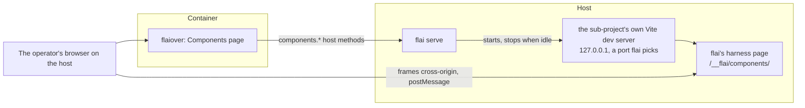

# The component library

The design of E-0026. The dashboard gets a Components page where the operator sees every component of their system, changes its props, and watches it follow changes to the design system and the source, live, without an IDE, a rebuild, or a redeploy. It takes up what [design-system-tool.md § The project's own components](design-system-tool.md#the-projects-own-components) left out of E-0020: rendering a project's components needs its own compiler and build, which only the host has.

The shape was settled on TH-0483. Each section names the story that builds it. Nothing here is built yet; this document says what is decided and is to be built, and each story brings its section up to date as it lands.

## How it fits together



The dashboard's container still holds nothing of the project ([ADR-0029](../adrs/0029-the-dashboard-reaches-a-project-only-through-flai-on-the-host.md), [ADR-0031](../adrs/0031-the-dashboard-s-container-holds-nothing-of-the-project-a-port-and-two-secrets.md)). flai on the host lists the components and runs the dev server. The page frames the dev server directly, which needs the operator's browser on the host.

## The catalogue (S-0437)

flai lists every component of a project's Svelte sub-projects and the props each takes, read with the project's own Svelte compiler ([ADR-0162](../adrs/0162-the-component-library-reaches-sub-projects-of-kind-sveltekit-or-svelte-finds.md)).

### Which sub-projects

A sub-project whose manifest `kind` is `sveltekit` or `svelte` is supported. `svelte` is a new kind, for a Svelte 5 app or library built with Vite but not SvelteKit. Every other sub-project is listed as unsupported, with its kind. Discovery, prop reading, and the harness sit behind a seam keyed by kind, so React and Vue can come later as adapters.

### The manifest key

A supported sub-project may carry `components`:

```yaml
projects:
  - name: flaiover
    path: flaiover
    kind: sveltekit
    components:
      include: ["src/lib/**/*.svelte"]   # default
      exclude: []                        # default
      setup: src/routes/layout.css       # default none
```

| Key | Default | Meaning |
|-----|---------|---------|
| `include` | `src/lib/**/*.svelte` | Globs, relative to the sub-project's folder, that find its components. The default leaves routes out. |
| `exclude` | none | Globs taken out of what `include` finds. |
| `setup` | none | A module of the sub-project the harness imports before any component, such as the app's stylesheet. |

The manifest's check reports a glob that does not parse, a `setup` that names no file, and `components` on a sub-project of an unsupported kind. [project-manifest.md](project-manifest.md) describes the key.

### Props

flai embeds a script, `props.mjs`, and runs it with the host's `node` in the sub-project's folder, so `svelte/compiler` is the sub-project's own installed copy. The script parses each component with the compiler's `parse` and the modern AST. A component is never imported or run to list it.

From the `$props()` destructuring it reads each prop's name, its default as written, whether it is required, and its TypeScript type as written. A local type alias, a local interface, or an inline object literal is resolved. An imported type is not: its kind is `unknown`, with its text kept.

| Kind | From a type such as |
|------|---------------------|
| `string` | `string` |
| `number` | `number` |
| `boolean` | `boolean` |
| `union` | `'sm' \| 'md' \| 'lg'`, with its literals |
| `array` | `string[]`, `Array<Item>` |
| `object` | an object literal, a local interface |
| `function` | `(id: string) => void` |
| `snippet` | `Snippet`, `Snippet<[Item]>` |
| `unknown` | an imported type, or anything else |

A component the compiler cannot parse is listed with its error. A missing `node`, or a sub-project without `svelte` installed, is an error that names what is missing and how to fix it.

### Commands

- `flai components list [--project <name>] [--json]` prints the catalogue: each component's sub-project, path, and name, and its props.
- `flai components config <sub-project> [--include] [--exclude] [--setup] [--unset]` writes the manifest key, keeping the manifest's other keys, order, and comments, and refuses a value the check reports. `flai manifest set` does not reach this key.

[flai-cli.md](flai-cli.md) describes both commands.

## The dev server and its harness (S-0438)

flai runs a sub-project's own Vite dev server on the host, with the project's own config, plugins, and dependencies, so aliases, Tailwind, and the design stylesheet behave as in the app. A plugin flai embeds serves a harness page that renders one component by its path, inside an error boundary, after the `setup` module. Vite's hot module replacement carries each saved change, to the source or the stylesheet, into the harness.

[ADR-0163](../adrs/0163-flai-runs-a-sub-project-s-own-vite-dev-server-on-127-0-0-1-behind-the.md) records the decision.

- flai writes a Vite config under `.flai-cache/components/<project>/<sub-project>/` that loads the sub-project's own config and merges flai's plugin into it, and runs the sub-project's own `vite` in its folder.
- The dev server binds 127.0.0.1 on a port flai picks. The browser on the host frames it; the dashboard's container never reaches it.
- Starting it runs the project's code on the host, so it sits behind a new host action, `components`, off until the operator runs `flai serve enable components`. `components.start` and `components.stop` are gated by it and journalled; `components.status` and `components.list` are reads.
- flai stops a dev server without a `components.status` call for `components.idle`, 30 minutes by default, and every dev server when `flai serve` stops.
- The harness at `/__flai/components/` imports the `setup` module, then mounts the component `?c=<path>` or a `select` message names, inside an error boundary.

### The protocol

The dashboard frames the harness cross-origin and talks to it by `postMessage`. Every message is an object with `source: "flai-components"`, `version: 1`, and `type`. The harness URL carries the page's origin as `?origin=`: the harness accepts messages only from that origin and posts only to it, and the page accepts messages only from the harness's origin and its own frame. Without `origin`, the harness renders `?c=` and posts nothing.

| From | Type | Fields | Meaning |
|------|------|--------|---------|
| page | `select` | `component`, `props?` | Mount this component, by its path in the sub-project, with these props. |
| page | `props` | `props`, `functions?` | Set the mounted component's props without remounting it. Each name in `functions` gets a logger that posts `event`. |
| page | `theme` | `theme` | Set `data-theme` on the document to `light` or `dark`. |
| page | `tokens` | `light`, `dark` | Lay these CSS custom properties over the stylesheet's, under `:root` and `[data-theme='dark']`; empty objects clear them. |
| harness | `ready` | `component?` | The harness has loaded and its `setup` module has run. |
| harness | `rendered` | `component` | The component mounted, or took new props. |
| harness | `error` | `component`, `message`, `file?`, `line?`, `column?` | The component failed to import or render; `file` and `line` say where. |
| harness | `event` | `component`, `name`, `args` | A function prop was called, with its arguments as far as JSON carries them. |
| harness | `size` | `width`, `height` | The rendered content's size, in CSS pixels, each time it changes. |

## The Components page (S-0439)

The dashboard's Components page lists every component of the project and renders the one the operator picks, live, from the project's own dev server. It is the second page of the Design group. It lists the catalogue by sub-project and folder, with a filter, and lists unsupported sub-projects with their kind. Picking a component frames the harness, in light and dark and at chosen widths. The page starts the dev server on request, keeps it alive while open, says how to enable the host action when it is off, and shows the harness's error, with the file and line, when a component fails to render.

## Controls for props (S-0440)

The operator changes a component's props on the Components page, a control for each from its type, and sees it render as they change. Each prop gets a control from its kind in the catalogue: text, a number input, a checkbox, a select of a union's literals, and a JSON editor for an array, an object, or `unknown`. A snippet takes text. A function prop is replaced by a logger whose calls the panel lists. Each change reaches the harness without remounting the component, and the props are kept in the page's URL.

## Live tokens (S-0441)

A token change on the Design page reaches the components on the Components page, as the operator tries it and once it is saved. A saved token rewrites the generated stylesheet (S-0436, [ADR-0150](../adrs/0150-a-token-save-from-the-design-page-lands-on-main-and-flai-writes-the-stylesheet.md)), and the dev server's hot update carries it into the frame. A tried, unsaved value is kept in the browser and sent to the harness, which lays it over the stylesheet's variables under the same names and theme selector as `flai design css` writes ([ADR-0159](../adrs/0159-the-generated-design-stylesheet-puts-the-dark-values-under-data-theme-dark-and.md)).

## A story's worktree (S-0442)

The Components page renders a story's worktree, so the operator sees a component an agent is changing live while the story is in progress or in review. The page offers a source: the main checkout, or a story. For a story, flai runs a second dev server in the story's worktree on its own port, and stops it when the story leaves review. The components its branch changes are listed first, and the review page links to them.

## Examples (S-0443)

A component's examples are kept under design/components, chosen on the Components page, and kept in step with its props by flai check. An example is a named set of props, for a component that renders only with data. Each component's examples are one JSON file under `design/components/<sub-project>/`, at a path that mirrors the component's path in the sub-project. The page lists them, loads one into the props panel, and saves a new one on main or on the story it shows. `flai check` reports an example that names a prop the component lacks, misses a required prop, or gives a value that does not fit its prop's kind.

## flaiover's own components (S-0444)

Every component of flaiover renders on the Components page, with the setup its stylesheet needs and examples for the components that need data. flaiover's manifest entry names its setup, `src/routes/layout.css`, written with `flai components config`, and leaves out only components that cannot render outside the app, each listed here with its reason. Each component that needs data gets an examples file under `design/components/flaiover/`.
